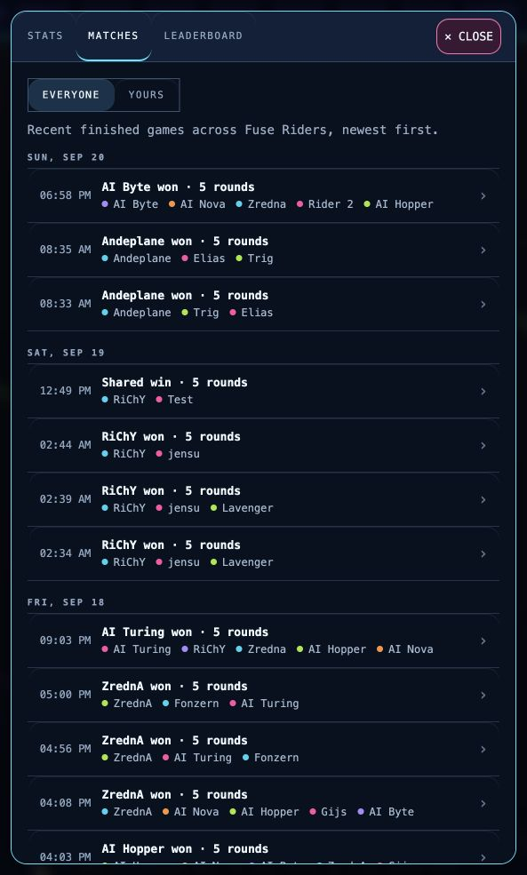
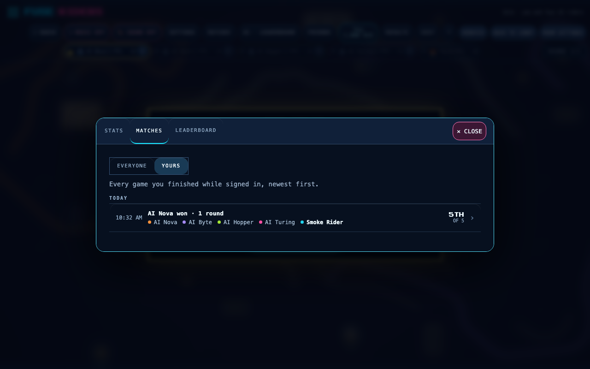

# Match history repair — 2026-10-14

Investigated the live EVERYONE tab showing one match while YOURS showed many. The deployed Pages manifest
identified source `bf491293549279fc1fa61c373c483519f756ee55`; Cloud Run served
`fuse-riders-gateway-00185-c4m` at 100% traffic.

In project `andershaf-87`, named database `fuse-riders`, collection `fuse-production-matches`, there were 383
confirmed records, 44 whole games and one existing `feedAt`. A dry run of `scripts/backfill-match-feed-at.ts`
identified 37 additional eligible whole games. After its focused tests passed, the existing repair script ran with
`ROOM_COLLECTION_PREFIX=fuse-production` and `--apply`. It added only `feedAt`, taken from each record's own
`endedAt`. A second dry run scanned 383 records and found zero missing eligible timestamps.

The live public API and browser then showed 20 matches on the first page, multiple dates and OLDER MATCHES.
No gateway or frontend deployment was performed for this data repair. Scores, account links and original dates
were unchanged.

For the reporting account, the latest linked whole game ended September 17 at 13:15:56 UTC. Newer linked round
receipts existed through October 6 at 09:59:31 UTC. Solo play sent round receipts but explicitly skipped whole-game
reports, so later solo play could update ratings without appearing in either match list or career totals. September
20 games under the same rider name were guest records, not linked to the account; names alone do not establish
account ownership. Past round receipts cannot establish that an entire match finished or reconstruct its full stats.

The accompanying code change adds authenticated completed-solo-game reporting and leaves historical round receipts
intact. That change requires the reviewed PR to be merged and deployed before production solo recording is fixed.

Local validation: the full unit suite passed (3,384 tests); focused history/report tests passed after the quota
correction, and typecheck/build plus focused lint passed. `scripts/solo-history-smoke.ts` played real one-round
signed-in and guest solo matches against the local service, using a typed test account adapter. The signed-in game
reported one confirmed whole game, appeared once in YOURS and EVERYONE, and opened its results; career count was
one and Elo stayed 1000. Guest play submitted no completed-game report. This does not verify production Google OAuth.

