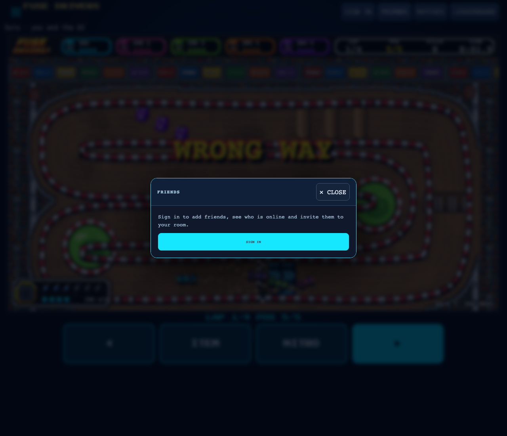

# Shared account and friends browser evidence

Real Fuse Craft and Fuse Lane menus, opened with `?mute`, captured by
`pnpm exec tsx scripts/shared-social-smoke.ts` on this branch.
The smoke checks every current game at 1280px and 390px: friends, sign-in handoff, matches,
dialog bounds and runtime errors. The twelve-game catalog includes Graveyard Shift and Fuse Drivers,
which landed after the original ten-game run; use `ONLY=graveyard-shift` or `ONLY=hook-havok,fuse-drivers`
for their focused integration checks. Phone width is browser emulation.

When `ONLINE_URL` is omitted, build first: the smoke starts and cleans up its own existing in-memory room
service on a free port. Graveyard's live solo check holds movement before opening ACCOUNT and FRIENDS,
then checks the hunter's public position across subsequent ticks and leaves native dialog arrow keys untouched.
Hook's live Spire check holds a real emulated touch charge while a native mouse click opens each social
dialog, checks that cancellation does not increment the throw tally, and checks that a fresh touch release
throws after closing. Chromium does not synthesize a native click from a second simultaneous touch;
this is mixed-pointer browser evidence, not a physical two-finger phone check. Drivers holds keyboard
and touch steering, opens each dialog, checks neutral steering across subsequent authoritative view ticks,
and verifies fresh steering after closing. Shared modal gates cancel held inputs without consuming native
dialog keys. The focused integration has 30 passing shared social, modal, name-contract and Drivers app tests;
typecheck, build and scoped lint also pass. The original PR's 3547-test baseline predates these integrations.

The Google popup itself was not authenticated with a real account. The separate
`scripts/friends-smoke.ts` exercises requests, acceptance, presence, notifications,
cross-game friendship visibility, invite navigation and removal on the real local backend
with injected identities.

