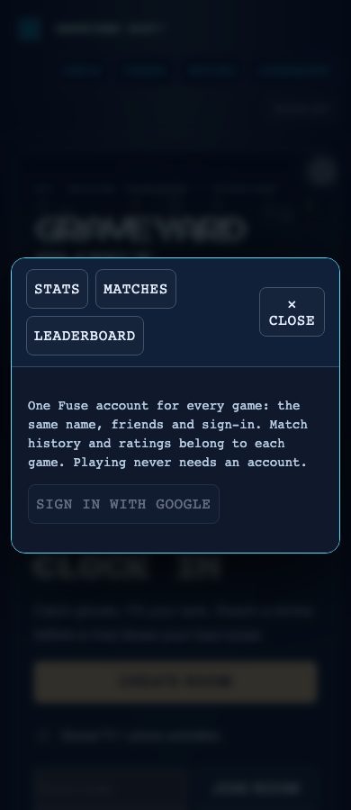
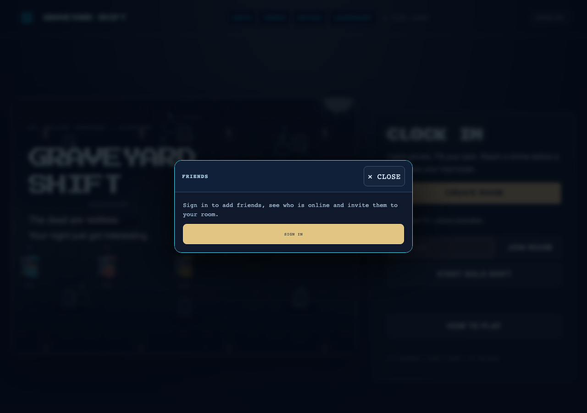

# Shared account and friends browser evidence

Real Fuse Craft and Fuse Lane menus, opened with `?mute`, captured by
`pnpm exec tsx scripts/shared-social-smoke.ts` on this branch.
The smoke checks every current game at 1280px and 390px: friends, sign-in handoff, matches,
dialog bounds and runtime errors. The catalog includes Graveyard Shift, which landed after the original
ten-game run; use `ONLY=graveyard-shift` for its focused integration check. Phone width is browser emulation.

When `ONLINE_URL` is omitted, build first: the smoke starts and cleans up its own existing in-memory room
service on a free port. Graveyard's live solo check holds movement before opening ACCOUNT and FRIENDS,
then checks the hunter's public position across subsequent ticks and leaves native dialog arrow keys untouched.

The Google popup itself was not authenticated with a real account. The separate
`scripts/friends-smoke.ts` exercises requests, acceptance, presence, notifications,
cross-game friendship visibility, invite navigation and removal on the real local backend
with injected identities.

