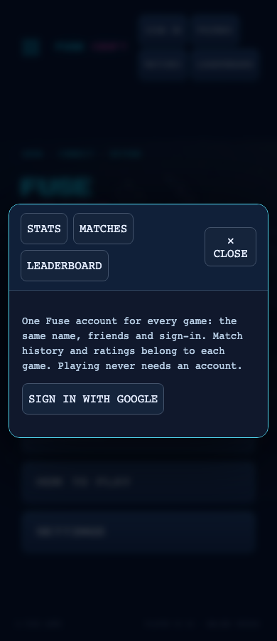
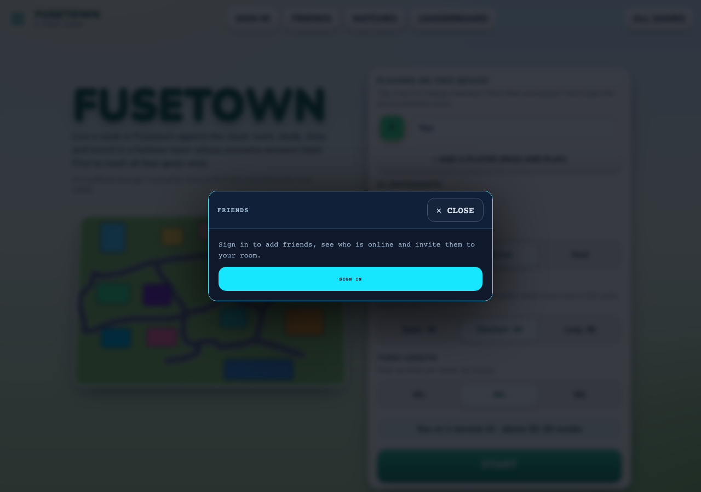

# Shared account and friends browser evidence

Real Fuse Craft and Fuse Lane menus, opened with `?mute`, captured by
`pnpm exec tsx scripts/shared-social-smoke.ts` on this branch.
The smoke checks every current game at 1280px and 390px: friends, sign-in handoff, matches,
dialog bounds and runtime errors. Phone width is browser emulation.

The Google popup itself was not authenticated with a real account. The separate
`scripts/friends-smoke.ts` exercises requests, acceptance, presence, notifications,
cross-game friendship visibility, invite navigation and removal on the real local backend
with injected identities.

