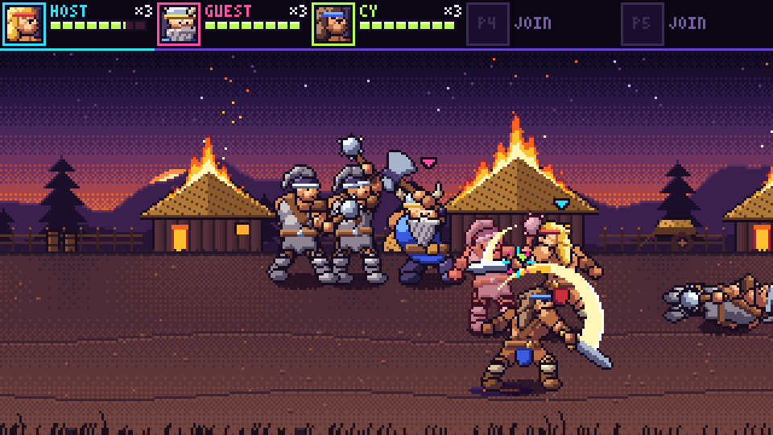

# Fuse Axe

A co-op pixel-art beat-em-up for 1–5 heroes in the spirit of Golden Axe II. Work in progress: see
[`docs/design.md`](docs/design.md) for the game and the delivery plan, and
[`docs/concept-art.html`](docs/concept-art.html) (open it in a browser) for the concept art.

## Play it

Open `/fuse-axe/` on a running service, or pick **Fuse Axe** from the app portal (the dot grid at the top left of
every game). **PLAY SOLO** opens the hero picker; **CREATE ROOM** makes a room to share by code, link or QR code,
where everyone picks a hero (duplicates are allowed) and the host presses **START**. The heroes walk, jump and swing
through Stage 1's waves of ravagers in the pixel-art scene under the HUD; phone pads and the shared screen follow.

| Keys          | Does                                |
| ------------- | ----------------------------------- |
| Arrows / WASD | Walk the road, up and down in depth |
| J / Z         | Attack                              |
| K / X         | Jump                                |
| L / C         | Magic                               |

```sh
pnpm build && pnpm exec tsx service/dev.ts   # then open http://localhost:8787/fuse-axe/?mute
pnpm exec tsx --test games/fuse-axe/tests/*.test.ts
node games/fuse-axe/preview/smoke.mjs http://localhost:8787/ [screenshot-dir]   # by hand, against the service
```

Production serves Fuse Axe rooms only once `EXTRA_GAME_IDS` names `fuse-axe` ([GCP deploy](../../docs/online/GCP-DEPLOY.md));
until then the page offers solo only.

## Sprites

Sprites are palette-indexed pixel data painted in code (`src/render/pixel/`): a rig paints shapes with surface
normals, lights them from the upper left into each material's three-shade ramp from the master palette
(`palette.ts`), edges overlapping parts and outlines the silhouette. A figure (`src/render/art/brakka.ts`) is a set of
poses, each joint positions on a small canvas plus a feet anchor; a new frame is a new pose, often
`adjust(idle, { near: { hand: [50, 40] } })`; a pose that paints onto its canvas's outermost pixels throws, so
widen `size` for a long reach. The renderer bakes a frame once per swap, flash and flip through
`createSpriteBaker(makeSurface).bake(sprite, { swap, flash, flip })` and draws it at `(x - ax, y - ay)`.

Every hero paints the same frames, `HERO_FRAMES` in `src/render/art/animate.ts`: a two-frame breath, a six-frame
walk, rise, fall and land, a wind-up, strike and follow-through for each of the combo's three swings, then hurt,
knockdown, down and getup; plus a 16 × 16 HUD portrait and palette swaps for up to five of the same hero. The kit's
`stride` lays out a walk's legs, `breath` an exhale and `bend` a knee or elbow (`armTo` and `legTo` place a limb from
its ends with another pose's bones), so a new hero only adds its poses. `pixel/head.ts` holds what every hero shares
above the neck: `turn(tilt)`, the body's frame for lying poses, `head` (skull, jaw, nose), `stampFace` for a hero's
`Faces` (calm, yell, pain, out), `beard`, `hornedHelm` and `portrait`, which paints the plate, shoulders and face and
takes the hair, headgear and face pixels. A shape's `grain` darkens a regular run of its pixels into strands, as a
beard's. A hero's `stride` reach is 1.5 × its `WALK_STEPS` × its walking speed in px per step (the engine's exact
sub-pixel speed: Gorm's 0.8 px is 205/256), so a planted foot stays put; `tests/hero-art.test.ts` checks that for
every hero in `HEROES`, which has art for every `HERO_KINDS` hero. Brakka (`src/render/art/brakka.ts`) swings a
broadsword; Rhea (`rhea.ts`) is slimmer, in bronze and green, with a longsword: a level slash, a thrust, and a spinning
overhead finisher. Gorm (`gorm.ts`) is a dwarf about three quarters of Brakka's height and broader, in a horned helm
and a blue tunic, with the kit's double-bit `axe` (its angle and haft length are pose fields) gripped in both hands
for the combo: a level hack, a rising uppercut chop, and an overhead cleave that bites into the ground, which hides
whatever reaches below the floor.
`heroFrame(kind, anim, animStep)` picks the frame for a hero in the view, timed by view-kit's `SWING_STEPS` and
`JUMP_RISE_STEPS`: the strike exactly in the swing's active steps (a hit's freeze holds it, as the engine stops
counting `animStep`), the walk at a cadence that keeps a planted foot still on a straight walk along the road. It
never throws, so a frame cannot stop the renderer: an odd `animStep` is rounded to a whole step from 0, and a new
engine state fails to compile until it has frames. `tests/animate-engine.test.ts` checks it against the real engine.

To see every figure's frames at 3× and 1×, each hero's swaps, flash, flip and portrait, and a reel per anim at game
speed, run `pnpm exec vite` and open `/games/fuse-axe/lab/sprites.html`. The lab is dev-only: it is not in the build
and not on the portal. [`docs/images/brakka-frames.png`](docs/images/brakka-frames.png),
[`docs/images/rhea-frames.png`](docs/images/rhea-frames.png) and
[`docs/images/gorm-frames.png`](docs/images/gorm-frames.png) are screenshots of it.

The ravager (`src/render/art/ravager.ts`) paints every frame on one canvas with one feet anchor, so its frames line
up on the floor; its falling poses are standing poses tipped over backwards (`tipped`). `RAVAGER_ANIMS` lists each
anim's frames with the simulation steps each shows, and `RAVAGER_TIERS` (rust, violet) recolour its tier ramp; ash is
its own palette. Below the sheet the lab packs each animated figure's frames onto one floor in every swap and plays
its anims; [`docs/images/ravager-lab.png`](docs/images/ravager-lab.png) is a screenshot of the ravager's.

## Scene

`src/render/scene.ts` draws one native 320 × 180 frame of the view: `createScene(make).draw(ctx, view, frame)`, where
`frame` counts 60 Hz frames and moves only scenery (fires, the GO flash); the app blends the two newest ticks
(`src/app/interpolate.ts`) before it calls it. In order: the backdrop, a soft dithered shadow on the floor under every
figure (narrower the higher it jumps), heroes and enemies by depth (further up the floor first, then lower before
higher, then by id) flipped to their facing, each hero's chevron in its seat's colour, the hit sparks
(`sparks.ts`), the grass in front and a flashing GO → when a cleared wave opens the road. An enemy in hit-stop
flashes, a tier wears its palette and a defeated one blinks out over `DEAD_STEPS`; an invulnerable hero (getting up,
or just risen) blinks its sprite, keeping its shadow and chevron. Heroes of one kind each get a palette of their own,
in seat order.
Nothing is drawn off screen (`pen.ts` clips every call), and every sprite, shadow and sign is baked once.

Everything the renderer pre-paints goes through one injected surface factory, `MakeSurface` in
`src/render/surface.ts`: `(w, h) => { image, paint, putPixels? }`. The page's (in `src/app/main.ts`) is a canvas with
smoothing off whose `putPixels` is `putImageData`; without it the backdrop's layers are replayed through `paint` a
run of a colour at a time, which draws the same pixels (about 77,000 rectangles for Stage 1, once).

[`docs/images/scene.png`](docs/images/scene.png) is Brakka fighting Stage 1's first wave in a solo game; it draws a
frame in well under a millisecond.

Over it all the HUD (`src/render/hud.ts`) is a strip along the top with a panel a seat: the hero's 16 × 16 portrait
in the palette it wears on the field, framed in its seat's colour; the player's name in a 3 × 5 pixel font
(`font.ts`: capitals, digits and a few marks; accents dropped, anything else left out, cut to fit); its lives as ×N;
a segmented health bar whose lost part trails white for a moment and then drains; and a row of magic pots, empty
until magic lands (`drawPots` takes held and max from the view then). A hero out of lives is greyed, one that cannot
be hit blinks with its sprite, an empty seat blinks JOIN (or names a player who joins with the next run), and this
device's seat is underlined. Names are not in the world: the app passes the room's, by seat, as the scene's
`draw(pen, view, frame, { names, you })`. Portraits and labels are baked once.


