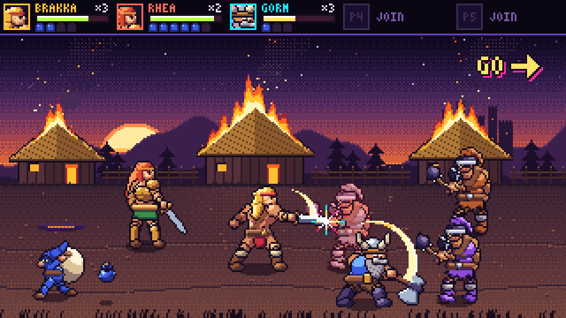

# Fuse Axe — game design

A co-op side-scrolling beat-em-up for 1–5 players, in the spirit of Golden Axe II: three sword-and-sorcery heroes
walk left to right through four hand-drawn pixel-art stages, cleave through waves of raiders, kick blue-hooded imps
for magic pots, steal the beasts their enemies ride, and finish at the keep of the warlord who shattered the Ember
Axe. A full run is about 15–20 minutes; one stage is 3–5.

Concept art: [`concept-art.html`](concept-art.html) (open it in a browser; everything is drawn from palette-indexed
pixel data in the page, `?still` freezes the animation).

The full line-up (heroes, enemies, mounts, the boss, magic and the palette) as one image:
[`images/concept-lineup.png`](images/concept-lineup.png).

## Story in one breath

The warlord **Vorhal** broke the Ember Axe that kept the realm's hearth-fires lit and carried the shards to his keep.
Villages burn behind his raiders. Three heroes take the road east.

## Heroes

Every hero has the same three buttons — **Attack**, **Jump**, **Magic** — and differs in reach, speed, power and
magic. Duplicates are allowed: a second Brakka gets a palette swap, so five players can pick freely.

| Hero                   | Weapon     | Feel                                             | Magic                                                                | Max pots |
| ---------------------- | ---------- | ------------------------------------------------ | -------------------------------------------------------------------- | -------- |
| **Brakka** — barbarian | broadsword | balanced reach, speed and damage                 | **Storm**: lightning strikes the screen; level 4 calls a thunderhead | 4        |
| **Rhea** — amazon      | longsword  | fastest and longest reach, lighter hits          | **Fire**: rolling flame wall; level 6 is a firebird                  | 6        |
| **Gorm** — dwarf       | battle axe | slow and short, hits hardest, hard to knock down | **Earth**: boulders fall; level 3 splits the ground                  | 3        |

Magic spends pots: tap Magic to cast at the level of every pot held (up to the hero's max), or hold Magic to charge
level by level and release early to save pots, as Golden Axe II allowed. Magic hits every enemy on screen, more at
higher levels, and never hurts other heroes.

Built (`src/engine/magic.ts`, tuned in `tuning.ts`'s `SPELLS`): a hero standing, walking or running with a pot casts;
never in the air, reeling or off its feet, and a Magic press made while busy waits a few steps as Attack's does.
Magic let go within `MAGIC_TAP` (0.2 s) is a tap and casts every pot; held longer, the level chosen starts at 1 and
rises one every `CHARGE_STEPS` (a third of a second) up to the pots held, shown in the view as the hero's `charge`. A
charging hero stands still and a hit breaks the charge with nothing spent. The cast spends the level's pots and the
hero stands invulnerable in `cast` for the spell's 1.5–2.5 s. Every enemy stands frozen, thinking nothing, until the
blow lands partway through; it strikes every fighting enemy wholly on screen (not one in a hero's hands or flying
from a throw) for a share of its full hit points, so a spell reads the same at every tier and party size, and knocks
it down away from the caster. Sack imps freeze with the rest but are never struck: their pots come from kicks. Two
heroes casting on one step land in id order. Magic's hit points count in the hero's damage, and casts and magic
damage are tallied too. The spell's blow in sixteenths of an enemy's full hit points, by level:

| Hero (spell)   | 1   | 2   | 3   | 4   | 5   | 6   |
| -------------- | --- | --- | --- | --- | --- | --- |
| Brakka (storm) | 4   | 7   | 10  | 13  |     |     |
| Rhea (fire)    | 3   | 5   | 7   | 9   | 12  | 15  |
| Gorm (earth)   | 5   | 9   | 14  |     |     |     |

## Moves

- **Walk** in eight directions on the floor: left/right along the road, up/down in depth (slower, as in the
  original). The floor is a depth band in the lower half of the screen.
- **Run**: double-tap left or right, on a phone's d-pad too: a quick tap, let go, and press again within a fifth of a
  second. The run is about twice the walk along the road (Gorm the slowest), still steers in depth, and ends when the
  direction is let go or reversed, or a blow lands. **Dash attack**: Attack from a run is a shoulder charge (Gorm's
  is a headbutt) that slides a short way and knocks down every enemy it meets in the lane, once each. **Running
  jump**: Jump from a run keeps the run's speed, so it carries further. A double tap made while the hero is busy
  waits a few steps, as presses do. Timing and speeds are `RUN_TAP`, `RUN_GAP`, `RUN` and `DASH` in
  `src/engine/tuning.ts`. If double-taps prove unreliable on glass in playtests, a phone gets a run toggle instead.
- **Combo**: Attack three times — two slashes and a heavy finisher that knocks down. A press while the blade is out
  or in the recovery chains the next swing; one in the wind-up is ignored, so the combo has a rhythm. A press made
  while the hero is busy (a swing's recovery, a landing) waits a few steps and acts as soon as the hero is free.
- **Throw**: walk into a dazed enemy and Attack to grab and throw them; a thrown body knocks down anyone it hits.
  A free hero holding toward a reeling (`hurt`) enemy close in front in its lane grabs it with Attack, holds it
  briefly (no mace lands meanwhile), then throws it over the shoulder: the body flies behind the hero, knocks down
  every enemy on its feet it meets in the lane and takes the throw's damage as it lands. Heroes are never grabbed;
  a kind can be made unthrowable (`THROWABLE`), as the Ogre twins are.
- **Jump** and **jump attack** (a downward stab): Attack in the air, from a standing or a running jump, stabs down
  from a few steps in until the hero lands, knocking down each enemy under or ahead of it in the lane once a jump.
- **Back attack**: on the floor, Attack and Jump pressed within a couple of steps of each other (the window is a
  tuning constant) strike behind you, for when you are surrounded. In the air Attack is always the jump attack.
  Neither press waits for the other, so a lone Attack slashes and a lone Jump leaves the floor on the step it is
  pressed: the second press, within `BACK_WINDOW` (one log tick) of the first, turns the slash still winding up, or
  the jump still leaving the floor, into the back attack. Both waiting as a busy hero comes free count if pressed
  within the window of each other. The back attack keeps the hero's facing (which a direction held on the step it
  begins has already turned, as for every move) and never comes from a run: there Attack
  dashes, and Attack in a running jump is the jump attack. Frame data is `BACK_ATTACK`, `JUMP_ATTACK` and the grab
  and throw constants in `src/engine/tuning.ts`.
- Heroes do not hurt each other.

Hits connect only when attacker and target are within a few pixels of each other in depth, so lining up on the road
is the core skill, as in the original.

## Enemies

| Enemy          | Role                                                                                                       |
| -------------- | ---------------------------------------------------------------------------------------------------------- |
| **Ravager**    | foot soldier with a mace; the bread and butter. Tiers by palette (ash, rust, violet) add HP and aggression |
| **Lancer**     | spear, longer reach, jumps in from the screen edge                                                         |
| **Brute**      | huge, slow, a club with knockback; takes several knockdowns                                                |
| **Bonewalker** | skeleton swordsman that claws up out of the ground (crypt stage)                                           |
| **Sack imp**   | blue-hooded thief carrying a sack; flees, drops a magic pot (or meat in camp) each time it is kicked       |
| **Ogre twins** | stage 1 boss pair with hammers                                                                             |
| **Vorhal**     | final boss: horned dark knight with a greatsword, a fire spell and summoned bonewalkers                    |

Enemies ride beasts in later stages. Knock a rider off and anyone can climb on:

- **Clawbeak** — a bipedal beaked beast; its tail sweep hits everything around it.
- **Ember drake** — a small dragon; breathes a stream of fire in front of it.

A mounted hero who takes a hard hit is thrown off and the beast wanders until someone else takes it.

A **sack imp** (`src/engine/imps.ts`) is sent by a cue in the stage's script (`STAGE_1.imps` in `stages.ts`: one
after wave 2, one alongside wave 3, one after wave 4; Wyrmbone Pass has two; a single imp whatever the party's size). It scurries in from a
screen edge and across the floor, zig-zagging in depth, never attacks and holds no wave's screen. Every blow that
lands on it kicks one pot out of its sack (2–3 per imp); it stumbles (a blow that knocks down sends it flying), then
flees away from the blow faster than any hero walks. Empty, it cannot be kicked; it leaves once off screen. A pot pops
out and lies on the floor for ten seconds, blinking at the end; a hero on its feet walks over it to pick it up, up to
its kind's most, and the lower id takes one two heroes reach on the same step. A hero keeps its pots through a lost
life and a continue, as in the original. Kicks count in no tally.

Enemies fight by the heroes' rules: they line up in the depth lane to hit, telegraph every blow with a wind-up a hero
can interrupt or step out of, and get no reach, speed or knockdown a hero lacks. At most two go for one hero at once,
from both sides where they can, while the rest hover at a distance; a hero swinging its blade is walked round. Their
choices draw from the world's seeded stream (`src/engine/ai.ts`, tuned per tier in `tuning.ts`'s `RAVAGER`).

The **Ogre twins** (`src/engine/ogre.ts`, tuned in `tuning.ts`'s `OGRE`) are Stage 1's last wave: one walks in from
each side, one green and one red, with a ravager more for each hero beyond the first. An ogre is half as big again as
a ravager, slow, and has hit points for the party's size, not its tier. Lined up, it raises its hammer in a long wind-up
and slams it down on a wide area in front, then a shockwave runs on along the floor in its lane (step out of the lane
or jump it); a hero close behind it draws a round sweep. After each blow it stands open. Its super armour shrugs off a
slash (the hit flashes but neither nudges nor stops it); a heavy blow staggers it while it stands or walks, and knocks
it down once it has taken a quarter of its hit points since it last fell. A spell always knocks it down but takes at
most an eighth of its hit points, and it is never grabbed. When one twin falls the other enrages and fights faster; a
boss bar across the top shows the twins' health together.

## Stages

1. **Ashen Village** — a dusk road through burning thatched huts. Ravagers and lancers; boss: the Ogre twins.
2. **Wyrmbone Pass** — a mountain path through the ribs of a dead giant wyrm. Mounts appear; boss: a lancer captain
   on an ember drake. Playable as gameplay for now (`STAGE_2`): five screens of road, five ravager waves mostly in
   rust and violet with two imps, and a pair of violet ravagers at the end in place of the captain until mounts come;
   it draws on Stage 1's backdrop until it has its own.
3. **Drowned Crypt** — a flooded graveyard under a broken cathedral; bonewalkers rise from the ground.
4. **Vorhal's Keep** — torch-lit halls to the throne room and Vorhal.

Between stages the heroes make **camp**: a short night scene by a fire where sack imps sneak in to steal; kicking them
drops pots and meat (meat heals). Then the next stage.

## Structure

- A stage is a long horizontal strip a few screens wide. The camera only moves forward and never leaves a hero
  behind: the leftmost hero holds the left edge, the screen edge holds everyone in.
- **Waves.** Trigger points along the strip spawn a wave and lock the screen until it is cleared; then a flashing
  **GO →** sends the party on. The last trigger is the stage boss. Enemies walk in from beyond the screen's edges,
  and one knocked out of a locked screen walks back in. Each stage is data in `src/engine/stages.ts` (`STAGES`: its
  road's length, waves and imp cues), and a world plays the one its `stage` names (`planOf`).
- **Scaling.** Wave size and enemy HP grow with the number of heroes: each hero beyond the first adds a spawn to
  every wave and a quarter to every enemy's hit points (`waveSpawns` and `enemyMaxHp`).
- **Life.** Each hero has a health bar and three lives. A hero who loses a life drops back in from the top after a
  short delay with brief invulnerability; teammates keep fighting. When every hero is out, the party may continue
  (once per stage) or the run ends.
- **Score.** Damage, knockdowns, throws and magic are tallied per hero and shown at each camp and at the end.

### Stage flow

The room (`src/online/game.ts`) runs it on the netcode's stages, so every peer folds the same outcome from the log:

- **Stage clear.** The tick the last wave is cleared (`stageCleared`), the room banks each hero's tallies from the
  world into the run's (`Room.tally`, so they outlive the stage's world), lets go of every held control and goes
  `between` for `CLEAR_TICKS` (6 s), showing the stage's tally over the frozen scene. A stage cleared as the last hero
  falls is still won. Past the last stage (`LAST_STAGE`, 2) the run ends `over` as a victory.
- **Continue.** When every hero is out (`defeated`), the world keeps running and a countdown of `CONTINUE_TICKS`
  (10 s) starts. A present human seated at a hero of the run votes by pressing Attack (or the CONTINUE button): a
  `CONTINUE` entry for the run and stage (`[seq, tick, 2, matchId, round]`). The first one folded in the countdown
  revives the party (`revive`: every hero drops back in at the camera with full health and every life, and the
  waves, enemies and camera stay as they were) and spends the stage's continue. Watchers, bots, a member who joined
  mid-run and an absent seat have no vote; a vote before or after the countdown, for another run or stage, or a
  second one is ignored. The countdown running out, or every hero out again with the continue spent, ends the run
  `over` as a defeat, with the stage's tallies banked.
- **Over.** The outcome and the run's tallies show with the stage reached; nothing is held and no clock runs. Hero
  picks apply again, and the host's REMATCH sets out on a fresh run (stage 1, nothing tallied) or LOBBY goes back.
  The page shows each as a card over the game (`src/app/presenter.ts`, `card`): [the countdown](images/app-continue.png)
  and [game over](images/app-game-over.png), from `preview/flow.mjs`.
- **The next stage** begins where a tally short of the last stage ends (`nextStage`): the next stage's world,
  seeded `seedOf("matchId:round+1")` as `beginStage` makes every stage's, with each hero whose seat is still here
  (its slot held by a member playing its hero: camp gives up a seat that leaves, so a bot taken off does not carry it
  on, nor does a newcomer in that slot playing another hero; the hero belongs to its slot, so one playing the same
  hero carries it on as the member who left would). Policy (`carryOf`): lives carry over (a hero who went out comes back with one),
  and so do magic pots, as in the original; health is full, the continue is fresh, and the tallies stay banked in
  the room, a hero that left keeping its row. With none of the run's heroes left the room is an empty lobby again.
  Camp will sit between the tally and the next stage.

The checkpoint carries the clock (`until`), the spent continue, the outcome and the banked tallies, and refuses any
combination the fold cannot reach (a clock in play with heroes standing, a win short of the last stage, a world of
another stage than the round or with no hero, tallies that are not the world's heroes: in a later stage, a row for
each of them in seat order, and once it has ended at least its own: what earlier stages banked for a hero is not in
the checkpoint to check against, so a later row is bounded below by its own stage only).

## Screen and art

- Native resolution **320 × 180**, scaled by whole numbers to fill the screen (6× at 1080p), nearest-neighbour.
- Heroes and grunts are about 32 × 48 pixels, bosses up to 64 × 72. Sprites face right and flip for left; every
  entity has a soft ellipse shadow on the floor, which also shows a jumping figure's depth. A small chevron in the
  seat's colour over each hero tells the players apart ([screenshot](images/scene.png)).
- Sprites are drawn from palette-indexed pixel data in code, so palette swaps (enemy tiers, duplicate heroes,
  damage flash) are free and no sprite sheet is checked in. (The PNGs under `docs/images/` are screenshots of the
  concept page, the sprite lab and the Stage 1 backdrop, for readers who cannot open them.)
- Draw order is by floor depth (further up the screen is further away), then by height.
- Parallax backgrounds (`src/render/backdrop/`, one module per stage): static layers are painted once and blitted at
  whole-pixel offsets, and only fires and torches draw per frame. Stage 1 has the sky, a ridge with Vorhal's keep (1/8
  speed), hills (1/4) and the village at the floor's speed behind the heroes, and grass (5/4) in front; it ends at the
  village gate ([screenshot](images/stage1-backdrop.png)). The scene picks the backdrop by the view's `stage`; a stage
  without art of its own draws Stage 1's, its camera scaled from the stage's road (`cameraEndPx(stage)` in
  `view-kit.ts`) onto the village's (`scenery` in `src/render/scene.ts`), so it never runs out of scenery; on Wyrmbone
  Pass's longer road that scrolls every layer at 3/4 of its speed, the floor-speed ones too, until it has its own art.
- Palette: warm dusk golds and embers against deep violet shadows, with the platform's neon accents for UI, magic
  and hit sparks. The HUD is a strip along the top: per hero a portrait, health bar, pots and lives
  ([screenshot](images/hud.png)); the pots light up to the level chosen while a hero charges magic.
- Spells (`src/render/spells/`, one module per kind) play over the field from the view's `spells`, timed by
  `SPELL_STEPS`: a dithered dusk, the kind's art growing with the level, and a flash and a render-only shake at the
  blow ([screenshot](images/spells.png)).

## Players, rooms and controls

- Online room play like the other Fuse games: each device controls its own hero, or a shared screen shows the game
  while phones act as controllers (a d-pad plus Attack, Jump and Magic). Built: the pads hold bits through the same
  `HeldControls` as the keys, so the engine sees one input path (`src/app/pad.ts`, `presenter.ts`'s `controller`).
- Local play on one machine: keyboard and gamepads.
- A solo player can bring bot companions. Bots press the same buttons as a human and get no privileged rules.
  Built: the host's + BOT in the lobby seats one, and the room folds `botInput` (`src/engine/bot.ts`) for its seat.

## Technical shape

Fuse Axe follows Fuse Choppers (`games/fuse-choppers/`), the closest existing game: an online rollback side-scroller
for up to five seats with bots, rooms and a shared screen.

- **Layers.** `src/engine/` is the deterministic simulation and imports nothing outside itself; `src/online/` is the
  `RollbackGame` for `fuse-netcode`, its codec and room runtime; `src/render/` draws the engine's view and imports
  only `engine/view.ts` and `engine/view-kit.ts`; `src/app/` owns the page, menus, rooms, input and audio.
  `tests/architecture.test.ts` enforces this, as in Choppers.
- **Simulation.** 60 steps a second, three steps per 50 ms log tick. Positions are integers in sub-pixel units
  (`px(n)`), so there is no floating-point drift between peers. Space is x (along the road), y (depth on the floor
  band) and z (height above the floor). Randomness is a seeded generator whose state lives in the world, so replay and
  rollback reproduce it. Entities are kept in id order and processed in that order.
- **Input.** Each seat logs its held bits — left, right, up, down, attack, jump, magic — in the netcode's per-tick
  entries, as Choppers does: every entry a seat logs in a tick is folded into the tick's first step (so a tap shorter
  than 50 ms still counts as a press) and the last one is held for the other two. The engine derives presses (double
  taps, combos, charge) from the previous step's bits, which live in the world and so in every snapshot: a late input
  rewinds and replays to the same presses, and none is lost to a rollback.
- **Rendering.** Canvas 2D at the native 320 × 180 into an offscreen canvas, copied to the page at the largest whole
  scale with smoothing off. Sprites are built once from palette-indexed data into offscreen canvases through an
  injectable surface factory, so tests can draw into a fake context.
- **Tests.** `node:test` via `tsx`; engine unit tests, codec round trips, an architecture test, and a golden test that
  plays a recorded bot run and checks world hashes and the `RULES` version. Browser smokes live in `preview/`.

## Delivery plan

Small pull requests, each reviewed and merged before the next one that depends on it:

1. Design outline, the package skeleton and the concept art.
2. Engine core: world state, fixed-step tick, seeded randomness, movement on the floor band, jumping, camera.
   Sprite pipeline: palette-indexed sprite data, surface builder, the heroes' idle, walk and jump frames. (In
   parallel.)
3. Renderer: stage 1 parallax backdrop, depth-sorted sprites, shadows, camera, with a preview page.
   Combat: combo, hit boxes, depth lanes, hitstun, knockdown, health and lives. (In parallel.)
4. Online: the `RollbackGame`, codec, checkpoint and room runtime.
   First enemy (ravager) with AI, waves, screen lock and GO. (In parallel.)
5. App shell: page, landing, rooms, hero select, controls, shared screen with phone pads, portal entry and service
   registration. The game becomes playable here.
6. HUD; run, dash attack, throw, jump attack and back attack.
7. Sack imps, pots and magic for each hero.
8. More enemies (lancer, brute), the Ogre twins and the stage flow.
9. Camp, stages 2–4, mounts, bonewalkers and Vorhal.
10. Sound effects and music (in: the effects, the jingles and the Stage 1 march); bot companions.
