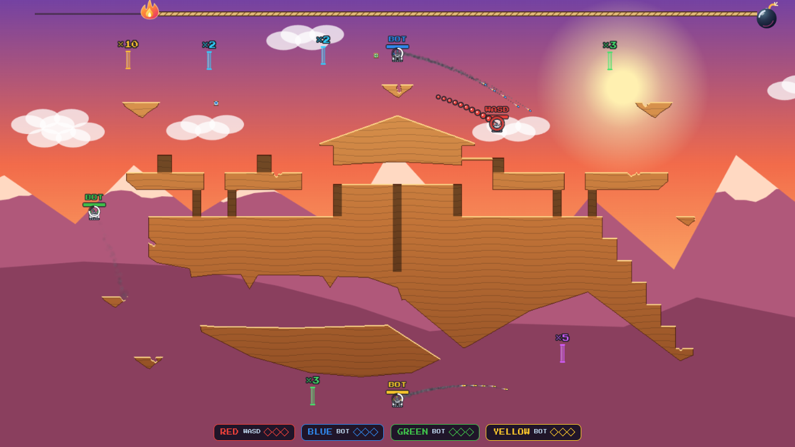
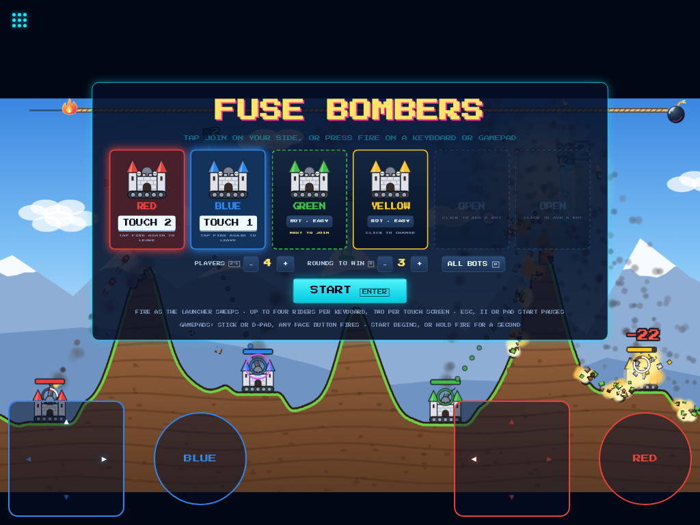
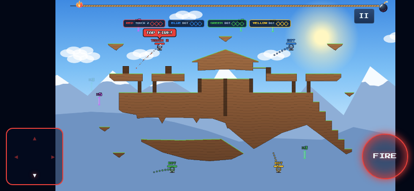
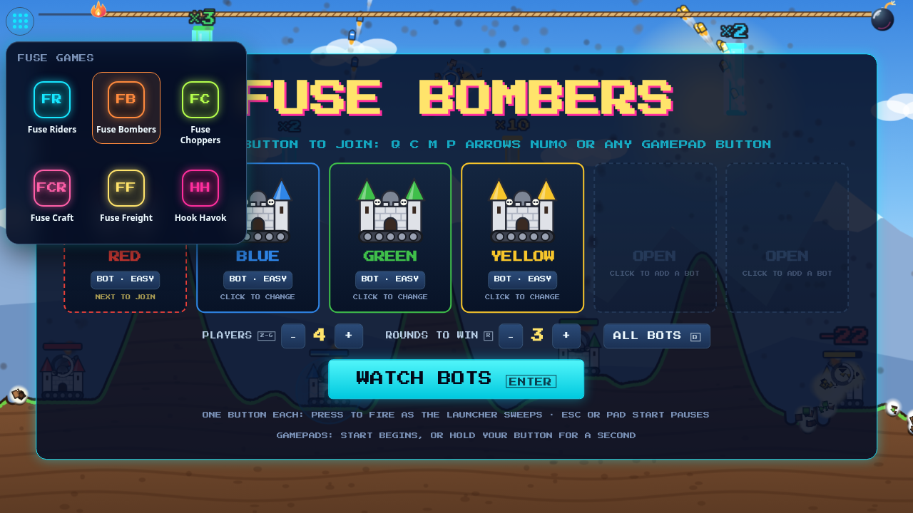

# Fuse Bombers

A party artillery game for 2–6 players, humans and bots, on one keyboard, a few gamepads or a touch screen. Gunships
fly round a destructible floating temple and lob rockets across it, and the rockets fly through multiplier gates to
turn a handful into a swarm. (Mid-overhaul, see [docs/design.md](docs/design.md): bots do not fly yet.)

**Play it: <https://andeplane.github.io/fuse-riders/fuse-bombers/>**, or pick it from the app portal (the dot-grid
button at the top left of every Fuse game's lobby). It is a local game: no rooms, no accounts, everyone at one screen.



## How to play

- **Fly and fire.** Steer your gunship in eight directions; it is heavy, so it takes a moment to get going, to stop
  and to turn round, and it slides along rock and bumps other gunships aside. Your launcher turns round and round, a
  full circle every 3.6 s. Press fire to fire a volley at the current angle, in any direction; the launcher then
  reloads. Holding fire does not fire again: press it again. Where you fly and when you press pick range and target,
  and a dotted guide shows the first part of the path. With the barrel against rock, the volley blows up there.
- **Gates multiply.** Gates (×2, ×3, ×5, ×10) drift in the sky. A rocket that flies through one splits into that many
  rockets, so five rockets through a ×10 gate is fifty.
- **Crates.** Floating crates give a card to the first volley that hits them: an extra rocket per volley, a shield, a
  faster reload, a repair or a mega bomb.
- **Terrain.** The whole temple is in view. Every rocket carves a crater, so the rock between the castles wears away
  over the round; only its darker skeleton (pillars, columns, the shrine's legs and keel) is indestructible.
- **The fuse.** The burning fuse across the top is the round timer (90 s). When it burns out, sudden death begins:
  bombs drop from above the castles and damage keeps growing. At 3 minutes the round ends on HP: the castle with the most HP wins, and
  a tie is a draw.
- **Ghosts.** When your gunship is destroyed you keep playing as a ghost blimp (your colour, your key on the side)
  that appears above your wreck. Fly it with the same controls, faster and straight through rock. Fire drops a bomb
  when one hangs under the blimp; a short dotted guide shows where it falls. Ghosts cannot win, but they can decide who
  does. Once every human is out and no ghost has flown or fired for a few seconds, the bots finish the round at up to
  double speed (⏩ in the bottom bar).
- **Winning.** The last castle standing wins the round (a wipe-out is a draw); if more than one is still standing at
  3 minutes, the highest HP wins (a tie is a draw). First to N round wins takes the match;
  N is 3 by default and set in the lobby (up to 9).

## Controls

In the lobby, press your fire key or button to join and press it again to leave. Seats up to the player count that
nobody holds are played by bots. One keyboard seats four riders and one touch screen two, so a lobby of six humans
needs gamepads too.

| Rider      | Steer                                                | Fire                                         |
| ---------- | ---------------------------------------------------- | -------------------------------------------- |
| Keyboard 1 | `W` `A` `S` `D`                                      | `Space`                                      |
| Keyboard 2 | `I` `J` `K` `L`                                      | `H`                                          |
| Keyboard 3 | Arrow keys                                           | `/` (the key left of right Shift)            |
| Keyboard 4 | Numpad `8` `4` `5` `6` (`2` is down too)             | Numpad `0` or numpad `Enter`                 |
| Gamepad    | Left stick (8 directions, with a dead zone) or D-pad | Any face button (A/B/X/Y on a standard pad)  |
| Touch      | Your side's D-pad; between two arrows is a diagonal  | The big FIRE button beside your side's D-pad |

Held together, opposite directions cancel. Keys are physical positions, so `/` is whatever the key left of right Shift
reads (`-` on Nordic layouts). A pad without the standard mapping steers with its first stick only, and all its
buttons fire. Menus: on a keyboard `Enter` confirms, `Esc` pauses or goes back and `Backspace`
quits; on a pad Start confirms and pauses, Back goes back or pauses, and holding fire for 1 s in the lobby starts; on a
touch screen tap the on-screen buttons, and the `II` corner button pauses.

Lobby shortcuts: `2`–`6` sets the player count, `R` cycles rounds to win (1–5; the `+`/`−` buttons go up to 9), `B`
cycles every bot's level (bots start on easy), and `Enter` starts. Click a bot to change its level. Mid-round, `Esc` or a pad's Start/Back
pauses; while paused, `Enter`/`Esc` resume and `Backspace` quits to the lobby. On the winner screen, `Enter`
plays again and `Esc` or `Backspace` returns to the lobby.

A gamepad that is unplugged and comes back at the same index is the same player.

Touch pads appear on touch devices (on a desktop, `?touch` shows them, and the mouse holds one control at a time): a
D-pad and a FIRE button in the bottom-left corner for one rider and in the bottom-right for a second, so two can share a
tablet. In the lobby both show, reading JOIN; press your side's FIRE to join and again to leave. In a match only the
seated sides show, and a lone touch rider's controls spread out, D-pad bottom left and FIRE bottom right. The pads step
aside while the pause, results or winner screen is up. A finger holds the control it went down on until it lifts, even
sliding off it; a cancelled touch, switching apps or tabs, or the window losing focus lets everything go.





### URL flags

Add them to the address, for example `?mute&speed=4`.

| Flag       | Effect                                                                                       |
| ---------- | -------------------------------------------------------------------------------------------- |
| `?mute`    | No music or sound effects for this load (`?mute=0` or `?mute=false` leaves them on).         |
| `?calm`    | Turns off screen shake and full-screen flashes (also on with the OS reduced-motion setting). |
| `?speed=N` | Runs the game and its timers N times as fast (whole numbers, 1 or more).                     |
| `?seed=N`  | Fixes the random seed so matches replay the same spawns, gates and crates.                   |
| `?touch`   | Forces the touch pads on a non-touch device.                                                 |
| `?debug`   | Exposes `window.fuseBombers` (`game`, `flow`, `audio`) for browser tests.                    |

## Development

Fuse Bombers lives in the Fuse Riders monorepo and uses its tooling: run everything from the repo root.

```sh
pnpm install
pnpm dev          # builds, then serves every game; this one is at http://localhost:8787/fuse-bombers/?mute
pnpm build        # type check (tsc --noEmit) and production build of every game
pnpm exec tsx --test games/fuse-bombers/tests/*.test.ts   # this game's suites (`pnpm test` runs the repo's)
pnpm lint         # eslint
pnpm format       # prettier --write (CI runs format:check)
node games/fuse-bombers/preview/flow-check.mjs     # Playwright: portal, lobby, match, winner and back (by hand)
```

`npx vite` from the repo root also serves it, unbuilt, at `/games/fuse-bombers/`. Open it with `?mute` so you do not
blast audio. The flow check starts its own Vite server and needs Chromium once: `pnpm exec playwright install chromium`.
`preview/browser-check.mjs` screenshots bots-only rounds and measures the frame rate against a running `pnpm dev`.
`preview/gunships.html` (dev only: `npx vite`, then `/games/fuse-bombers/preview/gunships.html`) shows the sky
overhaul's gunship and ghost art from `src/render/gunship-art.ts` in every state, at 1× and at the big map's 0.35×
zoom ([screenshot](docs/images/gunships.png)); the round draws them under a framing camera
([docs/engine.md](docs/engine.md), "Camera").

### Code

| Path          | Owns                                                                                                  |
| ------------- | ----------------------------------------------------------------------------------------------------- |
| `src/engine/` | Deterministic, fixed-step, seeded simulation: terrain, castles, rockets, gates, crates, fuse, bots.   |
| `src/render/` | Phaser scenes that draw the engine's state. No game rules or authoritative timers.                    |
| `src/app/`    | Entry (`main.ts`), menus and lobby, input (keyboard, gamepad, touch), audio, match flow, page styles. |
| `tests/`      | `node:test` suites; engine tests are `tests/engine*.test.ts`.                                         |

`src/engine/` imports nothing outside itself: no `render/`, no `app/`, no Phaser, no npm or `node:` packages, and no
DOM globals (`window`, `document`, `performance`, `Date.now`, `Math.random`). Randomness comes from the engine's seeded
RNG, time from the fixed step. Bots use the same input bits as humans and get no privileged physics.
[tests/architecture.test.ts](tests/architecture.test.ts) fails on a cross-layer import and on an engine use of
`Date`, `performance`, `Math.random` or of `Math`'s engine-dependent functions (`sin`, `atan2`, `hypot`, `exp`, `**`,
…): the engine computes the same bits on every browser, with its own trigonometry in `src/engine/det-math.ts`. Like
every game here, Fuse Bombers may use `packages/` but never another game; the repo's `tests/game-isolation.test.ts`
holds every game to that.

From the shared packages it takes the neon tokens (`fuse-ui/tokens.css`), the app portal (`fuse-ui/portal`) and the
music catalogue (`fuse-ui/assets`). Its music, the crate and the fuse's flame and bomb are the site root's shared
`public/` files (`music/`, `props/desert-industrial-v1/`, `themes/clean-neon/`), loaded through
`import.meta.env.BASE_URL`; everything else is drawn in code, and sound effects are synthesized. Its
`src/platform.ts` registers it with the room service for admission only (online play is in progress); it has no
accounts and reports no results. The portal sits in the lobby's top-left corner and hides once a match starts:



## More

- [docs/design.md](docs/design.md): the game design.
- [docs/engine.md](docs/engine.md): the engine.
- History before the move into this repo: [andreavs/fuse-bombers](https://github.com/andreavs/fuse-bombers).
