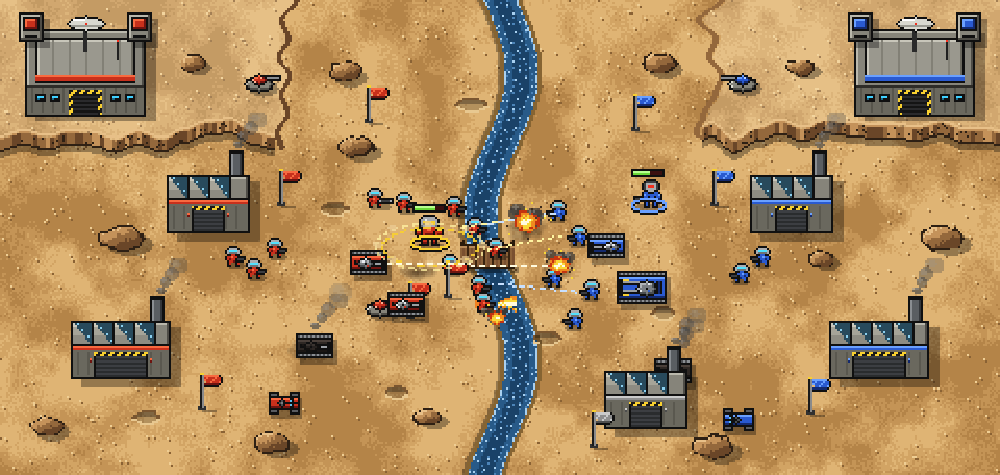
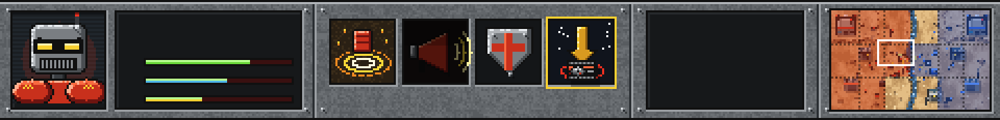
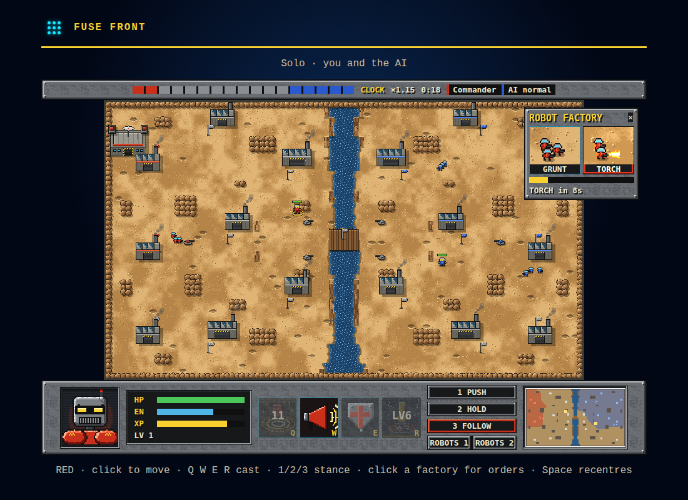
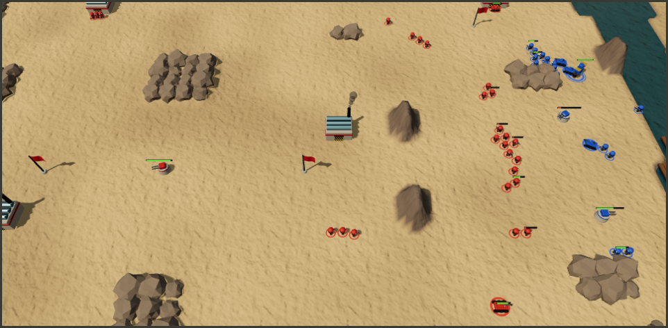
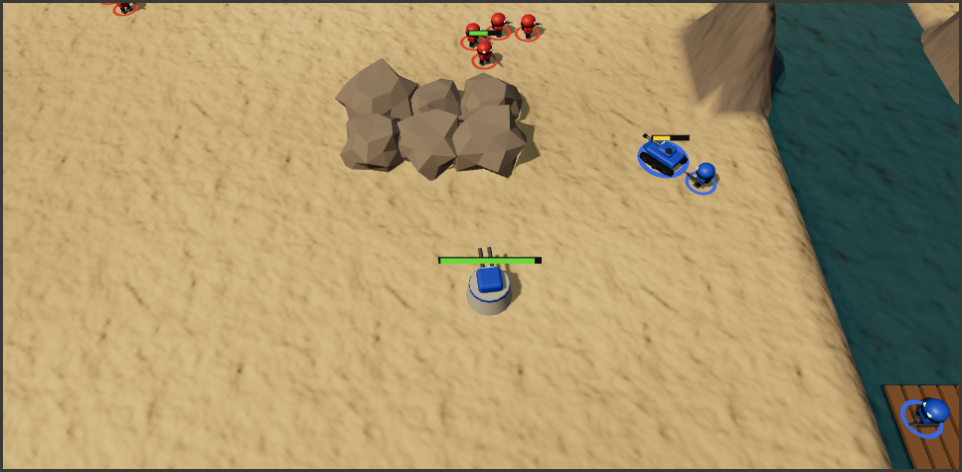

# Fuse Front — game design

A territory-war RTS for 2–6 players (1v1, 2v2, 3v3) that crosses **Z** (Bitmap Brothers, 1996) with **Warcraft
III**. From Z: the map is cut into sectors, each with a flag; touching a flag takes the sector and every factory in
it, and captured factories build robots and tanks on a clock that runs faster the more territory your team holds.
From Warcraft III: each player steers exactly one **hero** with spells and levels. Everything else on your side —
every robot and tank — fights on its own under a stance you set. Rooms are online; bots fill empty seats.

Concept sketches (generated by this game's pixel-art code, see [Art](#art)):





The interactive design canvas (hero select, factory orders, lobby):
<https://claude.ai/artifact/EqUHzuZdzt54bsZK67LuKf>.

## Pillars

1. **Capture.** A sector belongs to whoever last touched its flag with a robot or a hero (vehicles cannot capture,
   as in Z). Taking a sector takes everything in it: factories, gun turrets, the flag.
2. **Produce.** There is no money. A captured factory builds its current order on a loop. The build clock speeds up
   with the number of sectors the team holds. Your order sticks until you change it, and you can change it from
   anywhere.
3. **Lead.** You control one hero and nothing else. A hero has three spells and an ultimate (unlocked at level 6),
   levels 1–10 from XP for kills, captures and assists, and respawns at its fort when it dies. Robots near your hero
   fight harder (an aura), so where the hero goes decides the fight.
4. **Command.** One stance per player, applied to every unit that player's factories built:
   - **PUSH** heads for the nearest flag your team does not own, by path distance.
   - **HOLD** guards your team's flags, nearest threatened one first.
   - **FOLLOW** stays near your hero.

**Win:** destroy every enemy fort. A team's forts start in its home sectors and cannot be captured, only destroyed.

## Ownership in team games

Sectors, factories and units belong to a **player**, drawn in that player's team colour. The team shares the
production clock (team sector count), vision and the win condition. Each player's stance and factory orders apply
only to that player's units and factories, so in 3v3 everyone runs their own front. A sector taken by your hero or
robot becomes yours, even if a teammate held it before (re-taking a teammate's flag is a no-op).

## Prototype scope (v1)

- One map: **Dust Basin** (desert, a river with one bridge, 15–18 sectors, one fort per seat).
- One hero to start: **Brick** (frontline). Vix, Rivet and Tally follow, with the kits drawn on the design canvas.
- Units: **Grunt** (rifle robot, built in threes), **Torch** (flamer robot), **Light tank** (needs no driver in v1).
  Longshot, Buggy and Crawler follow.
- Buildings: fort, robot factory, vehicle factory, gun turret.
- Stances, factory orders, bots, online rooms for 1v1/2v2/3v3 from the first playable build.
- Shared-TV display mode with phones as controllers comes after the first playable build.

## Engine

Pure deterministic rules in `src/engine/` with nothing imported from outside it, following the repo's engine rules
(`AGENTS.md`). The facts that shape it:

- **Integer only.** Positions in sub-pixels: 16 per art pixel, 8 art pixels per tile. Distances compare squared
  integers. No `Math` in the engine. The RNG is mulberry32 with its state in the world, as in Fuse Axe.
- **Clock.** 20 Hz log ticks (`TICK_MS = 50`) with a fixed number of engine steps per tick. All timers count steps.
- **Map.** A tile grid (terrain: open, rock, water, bridge, cliff) loaded from a validated JSON file. The map lists
  flags, buildings and fort spawns per seat. Each tile's sector is the nearest flag by walking distance, computed when
  the map loads, so a map file never has to draw sector borders.
- **Movement.** Flow fields over the tile grid (8 directions, no corner cutting), one per goal tile. A flow field is a
  pure function of the map, so it is cached outside the checkpoint and rebuilt identically on any peer. Units steer
  along the field with separation from a spatial hash, in unit-id order.
- **Combat.** Units and turrets take the nearest enemy in range (spatial hash, ties by id) with a cooldown.
  Instant-hit shots in v1; shells with travel time later. Heroes are valid targets and grant XP to the killer's
  owner.
- **Scale.** A per-player cap on units (about 40, to tune) keeps 3v3 under about 300 units. When a player is at the
  cap, that player's factories pause. Step cost is budgeted so that a rollback re-run of 40 ticks stays well under a
  frame.
- **Snapshots.** Do not clone the whole world each step. Keep state compact (flat arrays of plain records), encode it
  as canonical JSON plus an FNV hash for checkpoints and golden tests, and validate it on decode.
- **Bots** are pure functions of the state that emit the same commands a player sends: hero moves and casts, stance
  changes and factory orders. They get no privileged information.

## Inputs

These are commands in the log, never held state:

- `move(x, y)`: walk the hero to a point (right-click or tap on the map).
- `steer(dx, dy)`: the held stick direction, for gamepads and phones. The latest command wins until it is released.
- `cast(slot, x, y)`
- `stance(push | hold | follow)`
- `order(factoryId, unitKind)`

Commands are capped per seat per tick.

## Netcode

A `RollbackGame` in `src/online/game.ts` on `fuse-netcode`, as in the other games: room seats 2/4/6, with empty
seats filled by bot commands folded in the ticker. Checkpoints are the canonical encoding. The renderer reads a
`WorldView` (`engine/view.ts`) and never the world itself.

## Presentation

A Canvas 2D renderer draws a fixed art-pixel viewport scaled by an integer with nearest-neighbour filtering, as Fuse
Axe does. Terrain is baked once per map into an offscreen canvas. Sprites (robots, tanks, buildings, flags, effects)
are drawn at runtime by the pixel-art code in `src/render/pixel/`. The HUD uses Z's look: riveted steel panels,
recessed bays, a hero portrait, spell icons, a stance switch and a minimap tinted by territory. The camera follows the
hero, with edge pan and a minimap jump.

`src/render/battlefield.ts` (R1) is that battlefield: it reads only `engine/view.ts` and `render/pixel/`, bakes the
ground per match, paints each sprite variant (kind × team × facing × frame) once into an offscreen canvas, and turns
engine events into tracers, flames, explosions, scorch decals and spell rings, accepting each event once per match by
its step stamp so a rollback re-run never plays a cue twice. Positions between two frames are interpolated for display
only.

The HUD (R2, `src/app/hud.ts`) is DOM dressed in pixel art painted once by `render/pixel/` and scaled 2x, so text and
buttons read, click and tap well; `app/hud-state.ts` derives its values into one reused record and only changes are
written. The minimap (`render/minimap.ts`, a pixel per tile, tinted by owner) redraws every 10 steps or on a capture.
Q/W/E/R cast at the hero's tile, 1/2/3 set the stance, and clicking one of your factories (on the map, or its HUD
button) opens its orders panel; a click there never moves the hero.



## Art

`src/render/pixel/` is the procedural pixel-art library: palettes, terrain, buildings, units, effects, portraits and
the chrome logo. It is browser-safe (it only fills RGBA buffers). `tools/art.ts` runs it in Node to write the concept
PNGs in `docs/images/`:

```sh
pnpm exec tsx games/fuse-front/tools/art.ts
```

## Delivery plan (PRs)

1. This design note, the pixel-art library and the concept-art CLI.
2. Engine I: map format and Dust Basin, sectors, flags and capture, buildings, the production clock, spawning, codec
   and a golden test.
3. Engine II: flow-field movement, separation, combat, stances, fort destruction and the win condition.
4. Engine III: hero Brick (movement, auto-attack, Q/W/E/R, aura, XP and levels, respawn).
5. Bots: hero, stance and factory orders.
6. Online: registration (`platform.ts`, `service/history.ts`, portal), the `RollbackGame`, rooms with 1v1/2v2/3v3
   seats and bot fill, and the lobby.
7. Renderer: terrain bake, sprites, effects, camera, HUD and minimap.
8. Controls: mouse and keyboard, touch, gamepad, and the factory-order panel.
9. Shared-TV display with phone controllers.
10. More heroes, units and maps.

## v2: powerhouse heroes, a real ending, bigger maps, 3D (2026-10-18)

Playtest of v1 found four problems. First, evenly matched teams stall at the unit cap and trade sectors forever.
Second, a hero feels like a bullet sponge rather than a powerhouse. Third, you cannot tell what your hero is
attacking or what a spell does. Fourth, the maps are small and units are hard to tell apart. v2 answers them.

**Ending the stalemate.**

- **Territory caps the army.** A player's unit cap grows with the team's sectors (a base plus a share per sector),
  so holding ground buys a bigger army, as Z's production did. An even trade at the cap tips toward the team that
  holds more.
- **Forts defend themselves** with a heavy gun.
- **Overtime.** After a set match time the team ahead on sectors builds faster, and the gap grows the longer it
  lasts.

Bot-vs-bot matches at every difficulty pairing must end within about 15 minutes on every map; a test enforces it.

**Heroes as powerhouses.**

- A hero is worth a squad. It has several times a tank's hit points, regenerates out of combat, takes reduced damage
  from robot small-arms fire, and hits hard with splash damage.
- Spells change fights. Shockwave flattens a crowd, Rally doubles a push, and Orbital Drop lands a heavy tank.
- Brick's kit is joined by Vix (infiltrator), Rivet (engineer) and Tally (scout), with the kits from the design
  canvas, in the same data-driven spell table.
- Each player picks a hero in the lobby, and bots pick a free one.

**Legibility.**

- **Focus fire.** A player can order the hero to attack a specific target: `attack(targetId)`, right-clicking an
  enemy. An attack-move order engages anything on the way.
- **What the view shows.** The view exposes each hero's current target, and the renderer draws a target line and
  marker.
- **Spells explain themselves.** Each spell carries its own metadata (name, one-line description, range, radius,
  targeting mode: self, point or unit) for tooltips. While aiming, the range and area of effect are shown before the
  cast. Aimed spells take a target point or unit.

**Bigger maps.**

- Maps grow to about the scale of Z and StarCraft: roughly 192×128 tiles for 1v1 and up to 256×192 for 3v3, with
  30–50 sectors.
- A deterministic map generator writes them as JSON from a seed and a template, with mirror symmetry for fairness.
  Dust Basin stays as the small map.
- Engine cost stays inside the rollback budget. Flow fields use typed arrays, the cache is sized to the map, and per-step
  work stays roughly linear in unit count.

**3D presentation (three.js).** The presentation moves from the 2D pixel canvas to a WebGL renderer on three.js. The
engine, netcode, `WorldView` contract and HUD logic stay as they are. The look keeps Z's world (desert war,
chunky robots, team-coloured forts and factories, the riveted steel HUD) but renders it realistically:

- **Terrain.** A heightmapped mesh built from the tiles: plateaus and cliffs, a carved riverbed with animated water,
  rocks. It uses procedural PBR materials (sand, rock, scorch decals) with triplanar texturing.
- **Lighting.** A sun with soft shadow maps, hemisphere and ambient light, fog, tone mapping, and a light bloom on
  muzzle flashes and explosions.
- **Camera.** A tilted RTS camera with zoom, pan, edge-scroll and follow-hero.
- **Models.** Units, heroes and buildings are procedural meshes built in code, with no downloaded assets. Each unit
  kind has its own silhouette and scale, so units can be told apart at a glance: grunt, torch, longshot, buggy, light
  tank and crawler, plus each hero with its own model and an always-visible team ring. Team colour goes on large
  surfaces. G2 builds them in `src/render3d/models.ts`: one merged geometry per paint per model, drawn as instanced
  meshes that share the kind's matrices, with the team colour per instance on the `team` paint only. Heroes wear
  Brick until the view names a hero kind (`heroKindOf`).

  
  

- **Draw cost.** Instanced meshes per kind keep ~300 units cheap. Effects (tracers, explosions, smoke, spell visuals)
  play from engine events, deduped by step as before.
- **Fallback.** The 2D pixel renderer stays available as a fallback for devices without WebGL2 until the 3D one
  covers them.

**v2 delivery (each PR under ~1,000 lines).** The engine lane runs E1–E4. The 3D lane runs G1–G4 in parallel.

- **E1:** powerhouse heroes and the stalemate breaker.
- **E2:** the other three heroes and the hero pick.
- **E3:** focus fire, attack-move, the target in the view, and spell metadata and aimed spells.
- **E4:** the map generator, bigger maps and engine performance.
- **G1:** three.js scaffolding, terrain, lighting, camera and placeholder meshes.
- **G2:** procedural unit, hero and building models.
- **G3:** effects, target lines, range and area-of-effect previews.
- **G4:** HUD tooltips and polish.
