# Fuse Front — game design

A territory-war RTS for 2–6 players (1v1, 2v2, 3v3) that crosses **Z** (Bitmap Brothers, 1996) with **Warcraft
III**. From Z: the map is cut into sectors, each with a flag; touching a flag takes the sector and every factory in
it, and captured factories build robots and tanks on a clock that runs faster the more territory your team holds.
From Warcraft III: each player steers exactly one **hero** with spells and levels. Everything else on your side —
every robot and tank — fights on its own under a stance you set. Rooms are online; bots fill empty seats.

Concept sketches (generated by this game's pixel-art code, see [Art](#art)):


The interactive design canvas (hero select, factory orders, lobby):
<https://claude.ai/artifact/EqUHzuZdzt54bsZK67LuKf>.

## Pillars

1. **Capture.** A sector belongs to whoever last touched its flag with a robot or a hero (vehicles cannot capture,
   as in Z). Taking a sector takes everything in it: factories, gun turrets, the flag.
2. **Produce.** There is no money. A captured factory builds its current order on a loop. The build clock speeds up
   with the number of sectors the team holds. Your order sticks until you change it, and you can change it from
   anywhere.
3. **Lead.** You control one hero and nothing else. A hero has three spells and an ultimate (unlocked at level 6),
   levels 1–10 from XP for kills, captures and assists, and respawns at its fort when it dies. Robots near your hero
   fight harder (an aura), so where the hero goes decides the fight.
4. **Command.** One stance per player, applied to every unit that player's factories built:
   - **PUSH** heads for the nearest flag your team does not own, by path distance.
   - **HOLD** guards your team's flags, nearest threatened one first.
   - **FOLLOW** stays near your hero.

**Win:** destroy every enemy fort. A team's forts start in its home sectors and cannot be captured, only destroyed.

## Ownership in team games

Sectors, factories and units belong to a **player**, drawn in that player's team colour. The team shares the
production clock (team sector count), vision and the win condition. Each player's stance and factory orders apply
only to that player's units and factories, so in 3v3 everyone runs their own front. A sector taken by your hero or
robot becomes yours, even if a teammate held it before (re-taking a teammate's flag is a no-op).

## Prototype scope (v1)

- One map: **Dust Basin** (desert, a river with one bridge, 15–18 sectors, one fort per seat).
- One hero to start: **Brick** (frontline). Vix, Rivet and Tally follow, with the kits drawn on the design canvas.
- Units: **Grunt** (rifle robot, built in threes), **Torch** (flamer robot), **Light tank** (needs no driver in v1).
  Longshot, Buggy and Crawler follow.
- Buildings: fort, robot factory, vehicle factory, gun turret.
- Stances, factory orders, bots, online rooms for 1v1/2v2/3v3 from the first playable build.
- Shared-TV display mode with phones as controllers comes after the first playable build.

## Engine

Pure deterministic rules in `src/engine/` with nothing imported from outside it, following the repo's engine rules
(`AGENTS.md`). The facts that shape it:

- **Integer only.** Positions in sub-pixels: 16 per art pixel, 8 art pixels per tile. Distances compare squared
  integers. No `Math` in the engine. The RNG is mulberry32 with its state in the world, as in Fuse Axe.
- **Clock.** 20 Hz log ticks (`TICK_MS = 50`) with a fixed number of engine steps per tick. All timers count steps.
- **Map.** A tile grid (terrain: open, rock, water, bridge, cliff) loaded from a validated JSON file. The map lists
  flags, buildings and fort spawns per seat. Each tile's sector is the nearest flag by walking distance, computed when
  the map loads, so a map file never has to draw sector borders.
- **Movement.** Flow fields over the tile grid (8 directions, no corner cutting), one per goal tile. A flow field is a
  pure function of the map, so it is cached outside the checkpoint and rebuilt identically on any peer. Units steer
  along the field with separation from a spatial hash, in unit-id order.
- **Combat.** Units and turrets take the nearest enemy in range (spatial hash, ties by id) with a cooldown.
  Instant-hit shots in v1; shells with travel time later. Heroes are valid targets and grant XP to the killer's
  owner.
- **Scale.** A per-player cap on units (about 40, to tune) keeps 3v3 under about 300 units. When a player is at the
  cap, that player's factories pause. Step cost is budgeted so that a rollback re-run of 40 ticks stays well under a
  frame.
- **Snapshots.** Do not clone the whole world each step. Keep state compact (flat arrays of plain records), encode it
  as canonical JSON plus an FNV hash for checkpoints and golden tests, and validate it on decode.
- **Bots** are pure functions of the state that emit the same commands a player sends: hero moves and casts, stance
  changes and factory orders. They get no privileged information.

## Inputs

These are commands in the log, never held state:

- `move(x, y)`: walk the hero to a point (right-click or tap on the map).
- `steer(dx, dy)`: the held stick direction, for gamepads and phones. The latest command wins until it is released.
- `cast(slot, x, y)`
- `stance(push | hold | follow)`
- `order(factoryId, unitKind)`

Commands are capped per seat per tick.

## Netcode

A `RollbackGame` in `src/online/game.ts` on `fuse-netcode`, as in the other games: room seats 2/4/6, with empty
seats filled by bot commands folded in the ticker. Checkpoints are the canonical encoding. The renderer reads a
`WorldView` (`engine/view.ts`) and never the world itself.

## Presentation

A Canvas 2D renderer draws a fixed art-pixel viewport scaled by an integer with nearest-neighbour filtering, as Fuse
Axe does. Terrain is baked once per map into an offscreen canvas. Sprites (robots, tanks, buildings, flags, effects)
are drawn at runtime by the pixel-art code in `src/render/pixel/`. The HUD uses Z's look: riveted steel panels,
recessed bays, a hero portrait, spell icons, a stance switch and a minimap tinted by territory. The camera follows the
hero, with edge pan and a minimap jump.

Big maps get a strategic zoom (`render3d/rig.ts`): the farthest zoom grows with the map (`farFor`) until it fits the
board, the camera tilts from 55° toward 74° as it pulls out, and past `MARKER_FROM` team discs, hero badges and flag
diamonds fade in at a constant screen size; fog recedes, the shadow box stops growing and ambient occlusion rests.
Keys: Z/X or +/- zoom a step, Space or F follows the hero, Home looks at the fort, Tab at the latest fight near your
side (`app/radar.ts`). A right click on the minimap moves the hero; a flag of yours under fire or lost pings it.

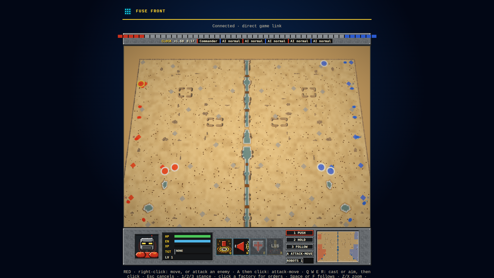

`src/render/battlefield.ts` (R1) is that battlefield: it reads only `engine/view.ts` and `render/pixel/`, bakes the
ground per match, paints each sprite variant (kind × team × facing × frame) once into an offscreen canvas, and turns
engine events into tracers, flames, explosions, scorch decals and spell rings, accepting each event once per match by
its step stamp so a rollback re-run never plays a cue twice. Positions between two frames are interpolated for display
only.

The HUD (R2, `src/app/hud.ts`) is DOM in the 3D robot style (glass panels, stroke spell icons, and hero portraits
rendered once from the 3D models by `render3d/portrait.ts`, pixel ones under `?2d`), so text and buttons read well; `app/hud-state.ts` derives its values into one reused record and only changes are
written. The minimap (`render/minimap.ts`, a pixel per tile, tinted by owner) redraws every 10 steps or on a capture.
Q/W/E/R cast at the hero's tile, 1/2/3 set the stance, and clicking one of your factories (on the map, or its HUD
button) opens its orders panel; a click there never moves the hero.

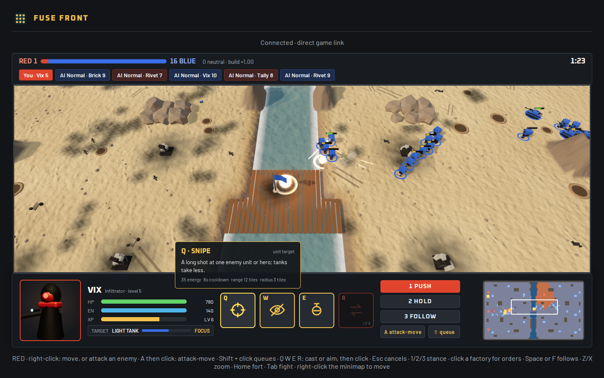 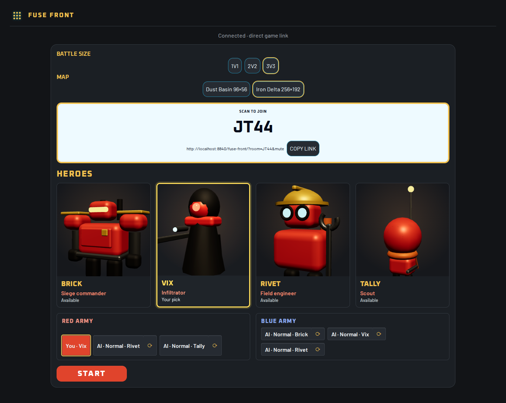

## Art

`src/render/pixel/` is the procedural pixel-art library: palettes, terrain, buildings, units, effects, portraits and
the chrome logo. It is browser-safe (it only fills RGBA buffers). `tools/art.ts` runs it in Node to write the concept
PNGs in `docs/images/`:

```sh
pnpm exec tsx games/fuse-front/tools/art.ts
```

## Delivery plan (PRs)

1. This design note, the pixel-art library and the concept-art CLI.
2. Engine I: map format and Dust Basin, sectors, flags and capture, buildings, the production clock, spawning, codec
   and a golden test.
3. Engine II: flow-field movement, separation, combat, stances, fort destruction and the win condition.
4. Engine III: hero Brick (movement, auto-attack, Q/W/E/R, aura, XP and levels, respawn).
5. Bots: hero, stance and factory orders.
6. Online: registration (`platform.ts`, `service/history.ts`, portal), the `RollbackGame`, rooms with 1v1/2v2/3v3
   seats and bot fill, and the lobby.
7. Renderer: terrain bake, sprites, effects, camera, HUD and minimap.
8. Controls: mouse and keyboard, touch, gamepad, and the factory-order panel.
9. Shared-TV display with phone controllers.
10. More heroes, units and maps.

## v2: powerhouse heroes, a real ending, bigger maps, 3D (2026-10-18)

Playtest of v1 found four problems. First, evenly matched teams stall at the unit cap and trade sectors forever.
Second, a hero feels like a bullet sponge rather than a powerhouse. Third, you cannot tell what your hero is
attacking or what a spell does. Fourth, the maps are small and units are hard to tell apart. v2 answers them.

**Ending the stalemate.**

- **Territory caps the army.** A player's unit cap grows with the team's sectors (a base plus a share per sector),
  so holding ground buys a bigger army, as Z's production did. An even trade at the cap tips toward the team that
  holds more.
- **Forts defend themselves** with a heavy gun that shoots units and heroes. Tanks outrange it, so tanks are the
  siege.
- **Overtime.** After a set match time the team ahead on sectors builds faster, and the gap grows the longer it
  lasts.

Bot-vs-bot matches at every difficulty pairing must end within about 15 minutes on every map; a test enforces it
(`tests/league.test.ts`, Dust Basin for now). The numbers live in `src/engine/tuning.ts` and `spells.ts`.

**Heroes as powerhouses.**

- A hero is worth a squad. It has several times a tank's hit points, regenerates out of combat, takes reduced damage
  from robot small-arms fire, and hits hard with splash damage.
- Spells change fights. Shockwave flattens a crowd, Rally doubles a push, and Orbital Drop lands a heavy tank.
- Brick's kit is joined by Vix (infiltrator), Rivet (engineer) and Tally (scout), with the kits from the design
  canvas, in the same data-driven spell table.
- Each player picks a hero in the lobby, and bots pick a free one. The kits, with their numbers and rules, are
  documented in `src/engine/spells.ts`; each hero's stat profile is `HEROES` in `src/engine/tuning.ts`. A pick is
  part of the room settings, so the host sets it for every seat. Each hero can be taken once per team, and the other
  team may repeat it. An unpicked seat takes the first free hero (`pickHeroes`).

**Legibility.**

- **Focus fire.** A player can order the hero to attack a specific target: `attack(targetId)`, right-clicking an
  enemy. An attack-move order engages anything on the way.
- **What the view shows.** The view exposes each hero's current target, and the renderer draws a target line and
  marker.
- **Spells explain themselves.** Each spell carries its own metadata (name, one-line description, range, radius,
  targeting mode: self, point or unit) for tooltips. While aiming, the range and area of effect are shown before the
  cast. Aimed spells take a target point or unit.

E3a built the engine side; `src/engine/focus.ts` documents the rules (a chase gives up only when the target is
unreachable or, for a unit or hero, beyond `CHASE_LEASH`). `HeroView.target` is the focus, or else the
enemy the gun picks next, and `HeroView.kit` is the kit's `SPELL_INFO`. A point spell aimed beyond `range + AIM_SLACK`
is refused without spending anything, and a `unit` spell may name its target in the `cast` entry's optional fourth and
fifth arguments.

**Command queue (shift-click).** `move`, `attackMove`, `attack` and `cast` take a `queued` flag (on the wire a
trailing `1`; entries without it mean what they always did). A queued order goes behind the hero's current one, up to
`QUEUE_MAX` (8); a plain order, a held stick or death clears the queue. When the current order ends (arrived, target
gone or given up) the next starts: an attack whose target has gone is skipped, and a queued cast that cannot be cast
when its turn comes (cooldown, energy, range, target) is retried while the hero stands for `CAST_WAIT` (one second),
then skipped. Orders queued while the stick is held wait for its release, and an attack-move standing to fight has
not ended yet. A plain cast stays instant and leaves the route alone. `HeroView.route` lists the current order and the
queue for drawing. `src/engine/orders.ts` documents the rules.

E3b adds the controls (`src/app/targeting.ts`, pure and tested):

- Right-clicking an enemy attacks it, and right-clicking the ground moves. A left click does the same, unless it lands
  on one of your factories.
- A, or the HUD's ATTACK-MOVE button, then a click on the map sends an attack-move.
- Q W E R cast a `self` spell at once. A `point` or `unit` spell starts aiming instead: the battlefield draws its range
  around the hero and its area under the cursor, and rings the bodies a unit spell may take. A left click casts it, and
  a right click or Esc cancels. A click out of reach keeps aiming.
- Shift queues: Shift + right-click on the ground or an enemy queues a move or an attack, Shift + A-click an
  attack-move (attack-move stays armed for the next waypoint), and Shift + Q W E R or Shift + an aiming click a cast,
  its reach measured from where the route ends. Releasing Shift cancels nothing. On touch, the HUD's QUEUE toggle does
  the same as holding Shift. While anything is queued, both renderers draw the route: a leg from the hero through each
  waypoint, with a marker per order kind (green move, amber attack-move with an inner ring, red double ring on an
  attack's target, violet cast with a centre dot), fading along the route.

  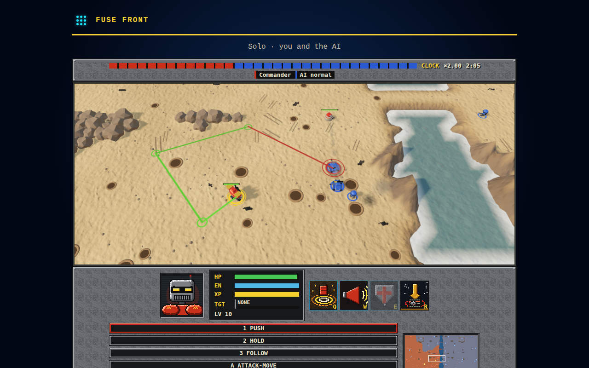

  `preview/queue-shot.mjs` takes this shot against a running service.

- The cursor turns into a pointer over an enemy.
- Each spell button has a steel tooltip with the name, description, cost, cooldown, range, radius and unlock level.
- The HUD's TGT row, under the hero's bars, names what the hero shoots, with its hit points, and marks it FOCUS when
  chosen.
- Both renderers draw a ring at the target and a thin line from the hero to it, in a colour no team uses. A newly
  chosen target pulses once.

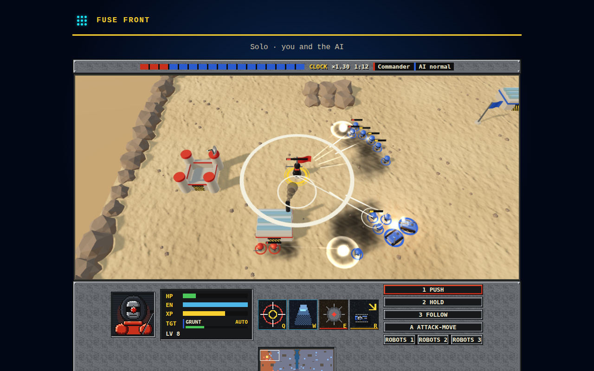
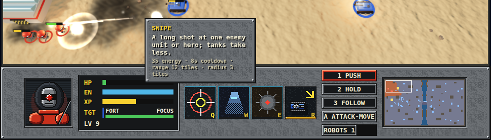

**Bigger maps.**

- Maps grow to about the scale of Z and StarCraft: roughly 192×128 tiles for 1v1 and up to 256×192 for 3v3, with
  30–50 sectors.
- A deterministic map generator writes them as JSON from a seed and a template, with mirror symmetry for fairness.
  Dust Basin stays as the small map. `tools/mapgen/generate.ts` draws the west half (river with bridges and fords,
  cliff-ringed plateaus with ramps, lakes, rock clusters), copies it east as a mirror or a half turn, places forts,
  Poisson-disc flags, a factory mix and turrets at the crossings and ramps, fills ground no fort can reach with rock,
  and checks the result with `loadMap` and the engine's flow fields. `tools/mapgen/templates.ts` holds the templates;
  `pnpm exec tsx games/fuse-front/tools/mapgen.ts` writes `maps/<id>.json` and `--check` confirms they are current.
- Engine cost stays inside the rollback budget. Flow fields use typed arrays, the cache is sized to the map, and per-step
  work stays roughly linear in unit count. E4 builds each field lazily (`src/engine/flow.ts`): a bucket-queue Dijkstra
  settles tiles only until the one asked about is settled, so a FOLLOW field around a moving hero costs a few tiles,
  and a tile's answer never depends on how far its field had grown. A full field on 256×192 takes about 3 ms (25 ms
  before), and the roaming cache shrinks on big maps to stay near 4 MB.
- The maps (`src/online/maps.ts`) are Dust Basin (96×56), Rust Canyon (1v1, 192×128), Glass Lakes (2v2, 224×160) and
  Iron Delta (3v3, 256×192). The host picks one in the lobby from those with a fort for every slot at the battle size.
  With none picked, or one too small for the size a start grows to, the match plays its size's generated map.
  `Settings.map` holds the pick and `play.map` the map the match plays. A checkpoint restores only onto that map.
- The renderers scale with the map. The 3D ground is cut into 64-tile chunks that cull one by one and share vertices
  and normals, so their seams match. A big map uses 2 vertices per tile edge instead of 3, and one water cell per tile.
  The minimap stays one pixel per tile at a fixed width.

  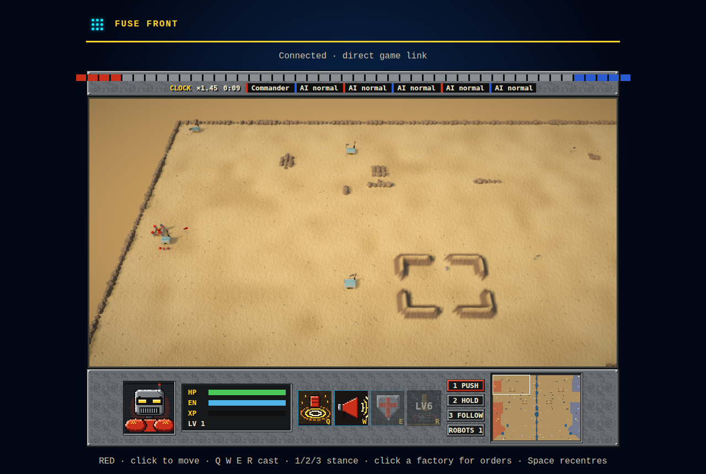

**3D presentation (three.js).** The presentation moves from the 2D pixel canvas to a WebGL renderer on three.js. The
engine, netcode, `WorldView` contract and HUD logic stay as they are. The look keeps Z's world (desert war,
chunky robots, team-coloured forts and factories, the riveted steel HUD) but renders it realistically:

- **Terrain.** A heightmapped mesh built from the tiles: plateaus and cliffs, a carved riverbed with animated water,
  rocks. It uses procedural PBR materials (sand, rock, scorch decals) with triplanar texturing.
- **Lighting.** A sun with soft shadow maps, hemisphere and ambient light, fog, tone mapping, and a light bloom on
  muzzle flashes and explosions.
- **Camera.** A tilted RTS camera with zoom, pan, edge-scroll and follow-hero.
- **Models.** Units, heroes and buildings are procedural meshes built in code, with no downloaded assets. Each unit
  kind has its own silhouette and scale, so units can be told apart at a glance: grunt, torch, longshot, buggy, light
  tank and crawler, plus each hero with its own model and an always-visible team ring. Team colour goes on large
  surfaces. G2 builds them in `src/render3d/models.ts`: one merged geometry per paint per model, drawn as instanced
  meshes that share the kind's matrices, with the team colour per instance on the `team` paint only. Heroes wear
  Brick until the view names a hero kind (`heroKindOf`). The robot units (grunt, torch, light tank, sentry) follow
  the 3D concept art and are built from the concept kit in `src/render3d/kit/`: a posed builder (`rig.ts`), a shared
  pixel-font atlas for stencilled squad numbers (`decals.ts`) and the units with their shared legs and tracks
  (`units.ts`). Every robot has a `near` and a `far` model; a unit past `LOD_FAR` tiles from the camera, or any unit
  at `?quality=low`, draws the far one (plain plates, no decals or small parts, steel drawn as the dark frame). The
  heroes follow the concept art the same way (`heroes.ts`): Brick's shoulders, star plate and shoulder cannon, Vix's
  hood, cloak and long rifle, Rivet's hard hat, crane arm and wrench, Tally's round head, antennae, scarf and jump
  jets. They pick near or far by `detailAt` too and walk on the robots' shared leg, scaled by `HERO_LEGS`.

  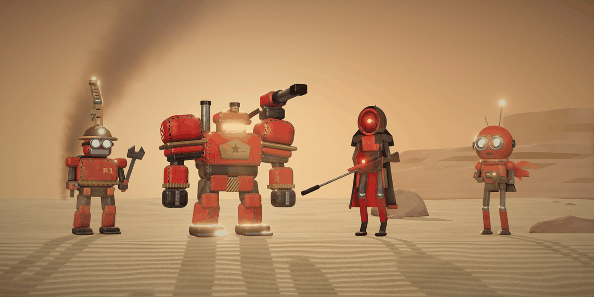 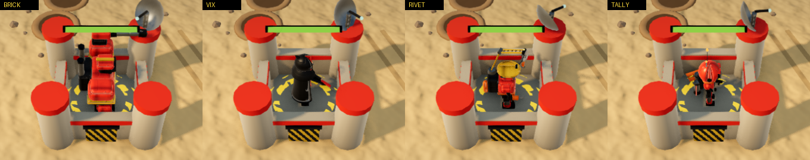

  The buildings follow it too (`buildings.ts`), near and far by `detailAt` per building: the fort's crenellated
  towers, keep, radar dish, banners and hazard gate round the open courtyard the hero respawns in, the robot
  factory's saw-tooth roof, banded chimney and ramp, the vehicle factory's MOTOR POOL hangar under a gantry crane,
  the turret's twin guns on a sandbagged pad, and each flag's sandbagged base under a team banner with the emblem.
  Team paint is grey while a building is neutral; a destroyed fort or turret leaves its own ruin.

  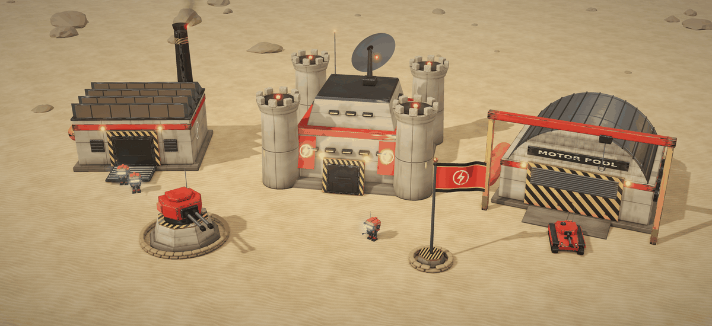 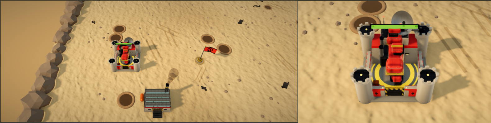

  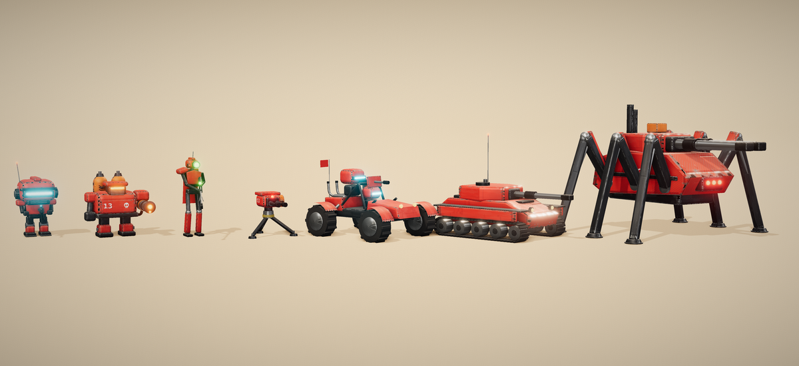
  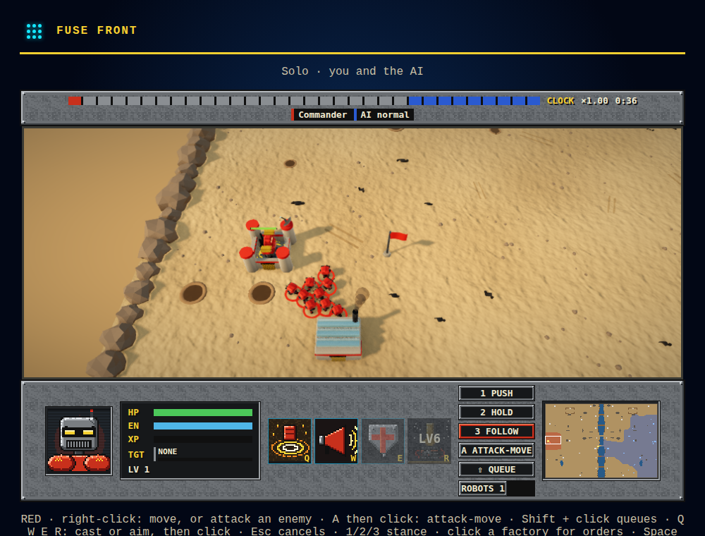
  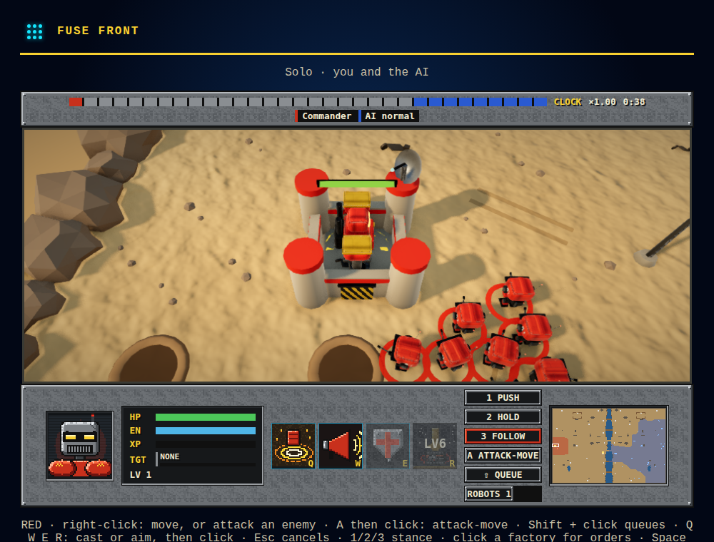

  
  
  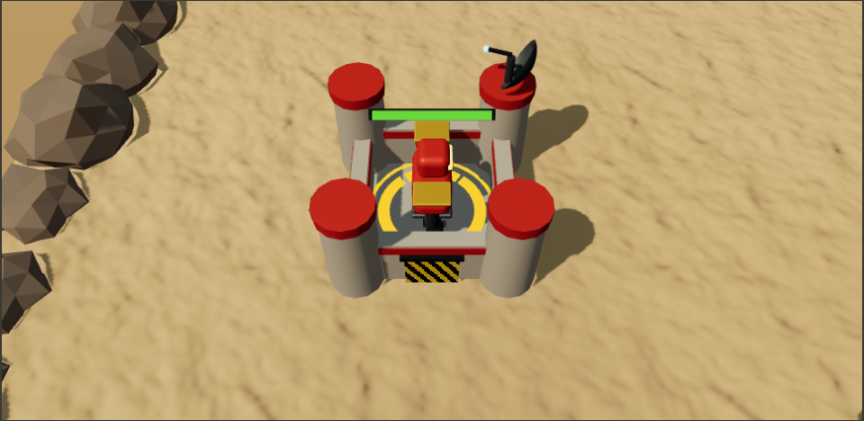

- **Draw cost.** Instanced meshes per kind keep ~300 units cheap. Effects (tracers, explosions, smoke, spell visuals)
  play from engine events, deduped by step as before.
- **Effects and finish (G3a).** `src/render3d/fx.ts` maps each deduped event to cues (team-tinted tracers, tank and
  turret shells on an arc with a smoke trail, torch flame jets, explosions with fireball, shock ring, debris, a smoke
  column and a scorch decal, and the spell, level-up and respawn rings and beams) and spawns them into a fixed
  particle ring drawn as three instanced quads (`effects3d.ts`), with four pooled point lights for flashes. `post.ts`
  adds a procedural sky for reflections, a team-tinted rim light, and at `high` quality GTAO, bloom, a warm grade with
  a vignette and FXAA. Quality starts high (low on a software rasteriser such as SwiftShader or llvmpipe) and drops
  to low for good when frames average over 34 ms, within about 25 frames even at a frame a second; `?quality=low|high` fixes
  it. The terrain gains wind ripples, damp river banks, pebbles and shore foam. `preview/render-probe.mjs` samples a
  long match's per-frame cost (draws, triangles, uploads, GPU-process CPU, live GL objects, heap); the shadow map
  draws once a frame, empty instance batches upload nothing, and pebbles are coarse and cast no shadow.

  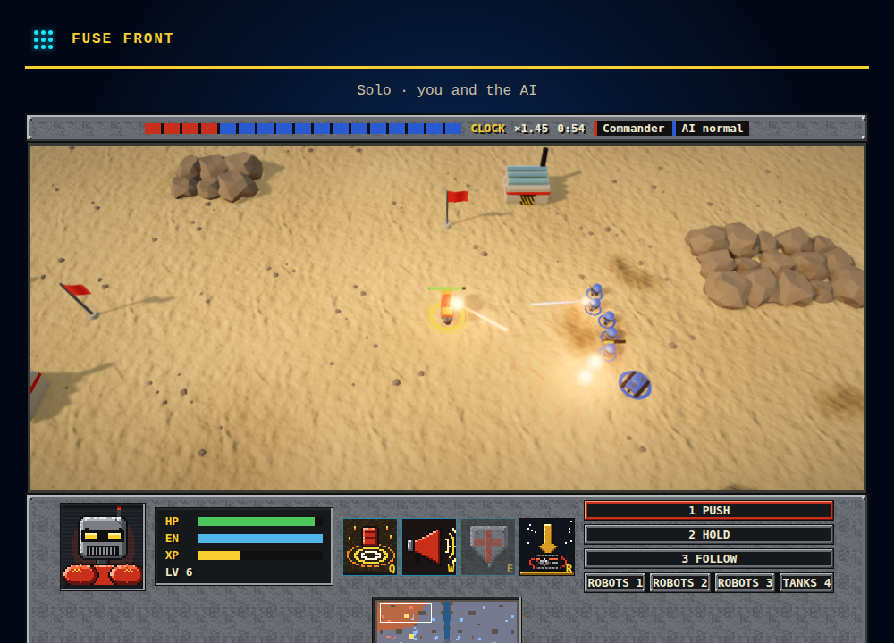
  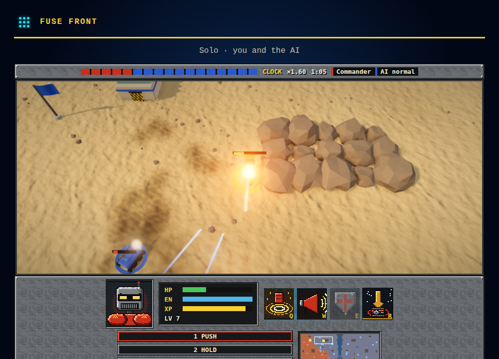

- **Detail and spell looks (G4).** Every part bakes vertex grime (darker toward the feet and under overhangs, worn
  bright on bevels) and the metal paints share one procedural panel map (grooves, a seam, rivets) for normals and
  roughness, dropped at `low`. Walkers' legs are one shared instanced leg swung per instance, tank treads scroll with
  how far the tank drove, and tanks, sentries and turrets kick back when they fire. Each kind has its own silhouette
  (bevelled tank hull, tripod sentry, Brick's pads, Vix's hood and rifle, Rivet's hard hat and wrench, Tally's antenna
  and scarf), drawn a size up at the default zoom. All twelve E2 spells have a look: a cast event carries where it
  landed (`toX`, `toY`, presentation only), so SNIPE, HIJACK and REPAIR draw beams to their target, DASH a streak
  from its start, and the rest play where they land; from the view, a cloaked Vix shimmers, mines blink, a fortified
  flag wears a dome, a FLARE burns over its tile, SPOTTER marks the units it exposes (`UnitView.spotted`) and BLITZ
  trails speed lines. Craters, tyre tracks and scrap litter the open sand (`props.ts`, three instanced meshes).

  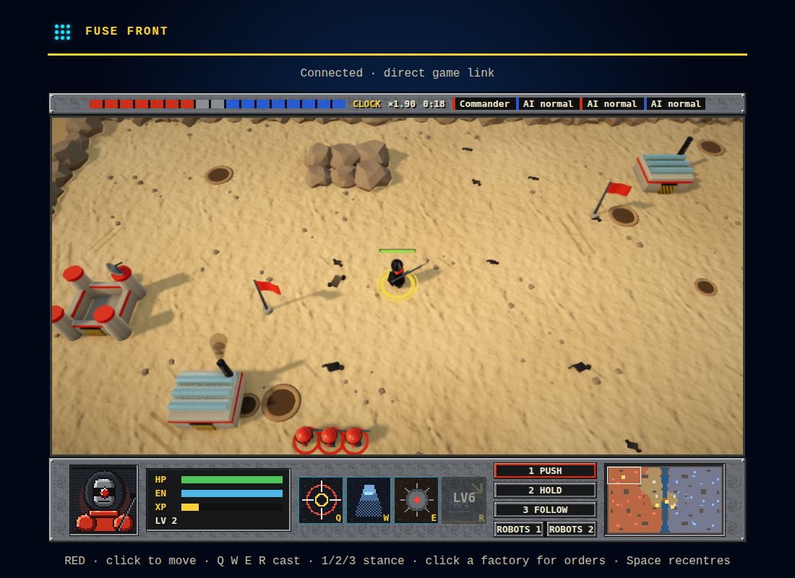
  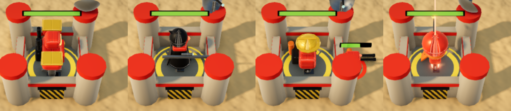

- **Fallback.** The 2D pixel renderer stays available as a fallback for devices without WebGL2 until the 3D one
  covers them.

**v2 delivery (each PR under ~1,000 lines).** The engine lane runs E1–E4. The 3D lane runs G1–G4 in parallel.

- **E1:** powerhouse heroes and the stalemate breaker (done).
- **E2:** the other three heroes and the hero pick (done).
- **E3:** focus fire, attack-move, the target in the view, and spell metadata and aimed spells.
- **E4:** the map generator, bigger maps and engine performance.
- **G1:** three.js scaffolding, terrain, lighting, camera and placeholder meshes.
- **G2:** procedural unit, hero and building models.
- **G3:** effects, target lines, range and area-of-effect previews.
- **G4:** HUD tooltips and polish.

## v3: a MOBA with Z's territory (2026-10-25)

Playing v2 made it clear that Fuse Front is a MOBA, not an RTS: you steer one hero, and the army fights on its own. v3
rebalances the game around MOBA principles and keeps Z's territory war as the twist. The user chose four things:

- three lanes with towers, plus Z sectors kept as jungle factories;
- gold and a small shop;
- automatic waves that captured factories upgrade;
- 15–20 minute matches.

**Map.** Three lanes (top, mid, bottom) join the two bases.

- **Towers:** each lane has two towers per side and a gate turret at the base. The base core is the fort, and
  destroying the enemy fort wins.
- **Protected structures:** the next structure down a lane can't be damaged while the one in front of it stands, so
  there are no backdoors.
- **Jungle sectors:** the ground between the lanes is jungle, cut into Z sectors. Each has a flag and a robot or
  vehicle factory, guarded by a neutral sentry camp. Lane ground has no flags; the towers are what you fight over.
- **Maps:** the map generator gains lane templates, with 3 lanes for 2v2 and 3v3 and a single mid lane for a 1v1 map.

**Waves instead of factory orders.**

- **Base wave:** every 30 s each lane spawns three grunts and a torch from each fort. They march down the lane on
  attack-move, fight the first enemies they meet, then push on to towers.
- **Growth:** waves get slowly tougher over the match, so a game always ends.
- **Factory upgrades:** a captured jungle factory upgrades its owner's waves while held. A robot factory gives grunt
  armour and an extra torch; a vehicle factory adds a light tank to every third wave. Losing the sector loses the
  upgrade.
- **Stance:** the stance switch and per-factory unit orders go away; the army is the lanes.

**Heroes and gold.**

- **Gold sources:**
  - a last hit on an enemy robot (the killing blow);
  - kills and assists on heroes, including a bounty that grows with the victim's kill streak;
  - towers, shared by the team;
  - jungle camps and captures;
  - a small passive trickle.
- **XP:** goes to every hero of the team within range of a death, so standing in lane matters.
- **Progression:** levels run 1–12, faster than v2, and respawn timers grow with level.
- **Healing:** a hero heals quickly at its own fort (the fountain).

**Shop.**

- About 12 items, bought at your fort, with 6 inventory slots.
- Basics cover damage, armour, hit points, energy, cooldown, move speed and attack speed. A few have an active or
  aura (a shield, a blink, a team heal), so a build is a real choice.
- Prices are tuned so that each hero finishes 3–4 items by minute 15.

**Towers and fairness.**

- A tower attacks the nearest enemy robot. It switches to an enemy hero that attacks a friendly hero inside its
  range.
- Tower damage ramps on the same target, so diving under a tower is a real cost.
- First-tower gold is shared.

**Bots.**

- Each takes a lane: 3v3 gives one per lane.
- They last-hit and retreat to heal at low health.
- They buy items from a build list for their hero.
- They take jungle factories when their lane is pushed.
- They join fights on their own side of the map.

**Pace.**

- The target is 15–20 minutes. Tower hit points, wave growth and respawn timers are tuned to it.
- The bot league test asserts that every match ends in that window. It's measured on the new lane maps for 1v1, 2v2
  and 3v3.

**v3 delivery (each PR under ~1,000 lines):**

- **M1:** lane maps: lane paths and tower slots in the map format, lane templates in the generator, and new maps.
- **M2:** waves, towers with protection and aggro rules, the core, and factory upgrades in place of unit orders.
- **M3:** gold, the shop, inventory, items and fountain healing.
- **M4:** hero progression and balance: XP sharing, levels 1–12, respawn scaling and bounties.
- **M5:** MOBA bots: laning, last hits, retreat, item builds and jungle captures.
- **M6:** UI: gold, the shop panel, item slots, lane and tower markers on the minimap, and the stance UI removed.
- **M7:** the 15–20 minute tuning pass with the league test.

**M1 as built.** A map file may carry `lanes`, `camps` and `symmetry` (`src/engine/map.ts`); maps without them load as
before, and M2 decides whether lanes become required.

- **Lanes:** each lane (`top`, `mid`, `bot`) has a `path` of 2–32 waypoints from team 0's base to team 1's. Each
  waypoint is walkable and joined to the one before by a straight line that walks without cutting a corner
  (`traceLine`). Each waypoint lies further from seat 0's fort and nearer seat 1's by the engine's flow fields, and
  the ends lie within 16 tiles of a fort of each team.
- **Sides:** a lane has one side per team, each with two towers (outer, then inner) and a gate. Every slot is on open
  ground within 4 tiles of the path and nearer its own fort than the enemy's, and each slot is nearer its base than
  the one before it. The gate also lies within 16 tiles of one of its team's forts. No slot or camp may stand on a
  factory's door.
- **Jungle:** on a lane map, every sector that isn't a fort's home is jungle (`GameMap.sectorKinds`). It holds exactly
  one camp and at least one factory. Its flag and camp stand more than 3 tiles from every lane path, because lane
  ground carries neither. Sectors still come from flags alone, so lane tiles still belong to the nearest sector.
- **Symmetry:** a `symmetry` field makes the loader check the map against its own image: terrain, flags, sites (fort
  2k against 2k + 1) and camps. It also checks each lane against the reversed image of a lane, with the sides
  swapped. Under a half turn that image is the other lane (top for bot); under a mirror it is the same lane.
- **Generator:** `tools/mapgen/lanes.ts` makes square, half-turn maps with corner bases and a river on the other
  diagonal. Top and bot bridge the river, mid fords it, and each jungle half has one more ford. The jungle gets
  Poisson-disc rock clumps and Poisson-disc flags, each flag with a robot or vehicle factory and a camp.
- **Maps:** Neon Duel (1v1, 176², mid only), Twin Wilds (2v2, 176²) and Crown Jungle (3v3, 180²) are committed but
  joined the room's map list in M2c, once they had waves, towers and a core. A grunt walks mid in 60–62 s and top or bot
  in 87–89 s (`mapgen.ts` prints the times).
- **View:** `WorldView.lanes` and `WorldView.camps` carry the paths and slots for the minimap and renderers.

**M2 as built.**

- **Waves (M2a, `src/engine/waves.ts`):** a map with lanes plays the lane rules, and its factories build nothing.
  - From 5 s, every 30 s each lane sends 3 grunts and a torch per team from the team's end of its path.
  - Each lane's wave belongs to the seat that plays it: one rider takes mid, two take top and bot, and three take one
    lane each.
  - A unit records its lane and its grade: its wave number, plus 20 for each enemy tower or gate its team had razed
    when it spawned (M2b). Grade n has `100 + 3·(n − 1)` percent of its kind's hit points and damage, capped at
    +1000 percent.
  - A team sends nothing more while 45 of its lane units stand. A drop's unit cap doesn't count wave units.
  - A lane unit picks its goal every step: an enemy turret or fort within 7 tiles, else the first waypoint it has
    neither reached (within 3 tiles) nor passed, else, past its lane's end, the nearest enemy fort.
  - It stands to fight anything in range and never seeks anything off its lane, so it doesn't wander into the jungle.
    FLARE doesn't draw it.
  - Bots walk their seat's lane on attack-move. The golden now plays Crown Jungle.
- **Towers and the core (M2b, `src/engine/towers.ts`):**
  - `loadMap` adds each lane side's slots as turret sites after the map's own: outer tower, inner tower, then gate.
    They have 1,800, 2,200 and 2,600 hit points. Each belongs to its team, credited to the seat that plays the lane.
  - A tower has a 7-tile range, 30 damage and fires once a second. It keeps the target it last shot while that stays
    in range; otherwise it takes the nearest enemy unit, else the nearest enemy hero.
  - When an enemy hero's shot hits a friendly hero and the tower has both in range, the tower switches to that enemy
    hero.
  - Each shot in a row on one target does 25 percent more, up to +150 percent.
  - **No backdoor:** no gun or attack picks a structure while the one in front of it on its lane and side stands,
    nor a team's fort while every gate of that team stands. Ruined lane structures stay down, so REPAIR skips them.
  - Destroying a team's last fort wins (`winnerOf`, unchanged).
  - **Momentum:** each enemy structure a team razes makes its later waves 20 grades tougher. Without it, mirror
    bots ground on in mid for an hour.
  - **Pace on lane maps:**
    - A hero's shots hit lane structures and forts at full damage (siege 100 percent, not 50).
    - A fallen hero waits 2 s more for each minute the match has run, so a kill late in the match opens a real
      push window.
    - A drop or hijacked tank follows its hero rather than walking to jungle flags.
  - **Bots:** with no enemy hero within 16 tiles, a bot attacks the nearest enemy structure it may shoot within 12
    tiles.
  - Mirror bot matches now end: normal 1v1 on Neon Duel at 36 min, 2v2 on Twin Wilds at 37, 3v3 on Crown Jungle at 47. M7 tunes them to 15–20 min.
- **The jungle (M2c, `src/engine/jungle.ts`):**
  - **Camps:** each camp holds 2 neutral sentries (owner −1) on its tile. They never move or burn out. They shoot only
    heroes and units outside the waves, and only those shoot them, so waves pass a camp untouched.
  - A camp whose guards are all down stands again 60 s later.
  - A guard's kill pays only the killer's team, and a kill no seat made pays nobody.
  - A hero's splash reaches guards only from a shot at their camp. HIJACK can't take a wave's tank.
  - **Capture:** on a lane map only jungle flags can change hands, and not while their camp is guarded.
  - **Upgrades,** while the sector is held:
    - a robot factory adds a torch to its nearest lane's wave, and the team's wave grunts take 25 percent less from
      guns;
    - a vehicle factory adds a light tank to its nearest lane's every third wave.
  - **Bots:** with no enemy unit or hero within 16 tiles, a healthy bot detours up to 30 tiles to take a jungle flag (not one
    under FORTIFY), fighting its camp.
  - **Room:** the room now lists only the lane maps, Neon Duel, Twin Wilds and Crown Jungle, which are each size's
    default. The v2 maps still load for tests and tools, and they keep their factory rules.
  - **League:** it runs on the lane maps (rules `fuse-front-14`, seed 1).
    - Neon Duel 1v1: 10.1 to 20.3 min across 8 pairings.
    - Twin Wilds 2v2 normal: 21.9 min.
    - Crown Jungle 3v3 normal: 14.2 min.
    - Its bound is 45 min.
- **Commands (M2d):** the factory order and stance commands are gone from the engine (`Command`), the checkpoint (a
  player is `[seat, team]`) and the wire. `isEntry` refuses control kinds 0 and 1, and the other kinds keep their
  numbers.
  - On a v2 map units always push. With nothing to take they fall back to their fort, so HOLD's spread over the
    team's flags went too.
  - On a lane map a unit outside the waves follows its hero.
  - The HUD loses its stance buttons and 1/2/3 keys. Its factory panel still shows what a factory builds, with
    inert choices, until M6 removes it.
  - Bots no longer choose stances or orders. RULES `fuse-front-15` refuses older checkpoints.

**M3 as built.**

- **Gold (M3a, `src/engine/gold.ts`, numbers in `GOLD`):** each player's purse lives on its hero, checkpointed with
  its kill streak and its recent hits.
  - A hero starts with 300 and earns 1 a second, dead or alive.
  - **Last hits:** the first hero whose shot or spell lands on an enemy unit on the step it dies earns the unit's
    bounty: 20 a grunt, 25 a torch, 50 a tank, 30 a sentry, 35 a camp guard. A robot's or tower's shot never earns
    gold.
  - **Hero kills:** the killer's seat earns 200, plus 50 for each kill the victim made since it last fell (up to 6).
    Half as much again is split evenly among the killer's living teammates within 8 tiles whose hero hit the victim
    in the last 10 s.
  - **Structures and flags:** a razed lane tower or gate pays every hero of the razer's team 150, 200 or 250 by tier.
    Taking a flag pays its taker 75.
- **The fountain (M3a):** a living hero within 3 tiles of its own fort's tile heals 0.5 percent of its hit points
  and 1 energy a step, about five seconds from empty to full.
- **Measured** (rules `fuse-front-16`, seed 1, bots that don't shop yet): a hero has earned about 2,000–3,000 by
  minute 5, 3,500–5,700 by minute 10 and 5,900–6,900 by minute 15 on Neon Duel, Twin Wilds and Crown Jungle. Match
  lengths are unchanged.
- **HUD:** the gold counter sits at the right of the hero's name.
- **Items (M3b, the table in `src/engine/items.ts`, the rules in `src/engine/shop.ts`):** twelve items in four
  categories (weapons, armour, systems, special), 6 slots a hero.
  - **Stats:** gun damage, armour, hit points, energy, spell cooldown cut, speed and haste (faster reload). They add
    up, with armour capped at 50 percent, cooldown cut at 40 and haste at 100. An item's hit points and energy come
    with it when bought and go when it's sold.
  - **Actives and the aura:** the Aegis Projector's SHIELD halves the damage taken for 4 s (40 s cooldown). The Phase
    Coil's BLINK jumps to an open tile within 6 tiles (25 s). The Mender Beacon heals its carrier and allied heroes
    within 6 tiles 20 hit points a second.
  - **Buying and selling:** a living hero buys and sells only in its own fort's courtyard. A buy takes the first empty
    slot and needs the gold. A sale refunds half the cost.
  - **Commands:** `buy(item)`, `sell(slot)` and `useItem(slot, x, y)` go on the wire as control kinds 7, 8 and 9.
    `isEntry` checks their shape and ranges, and the engine refuses one it may not do, which then does nothing.
  - **Checkpoint:** each hero adds its items, its slots' cooldowns and its SHIELD. RULES is `fuse-front-17`.
  - **Since review:** an active still cooling can't be sold, so selling and rebuying never refreshes it. BLINK
    crosses walls but lands only on ground its fort's flow field reaches. A fall ends a SHIELD.
- **Bots (M3c, `src/engine/bot-shop.ts`):**
  - At its fort a bot buys the next item of its hero's build (`BUILDS`) that it can afford, one a tick, every tick.
    Bots don't retreat yet (M5), so they shop when they respawn.
  - It raises its SHIELD when below half health and hit or near an enemy hero. It BLINKs onto a hurt enemy hero
    that is just out of its gun's reach, landing a tile inside it.
  - It takes a cheap last hit, an enemy unit three quarters of one shot finishes (armour and IRON HIDE can cut a
    shot), before pushing a structure or walking on. Its BLINK aim passes the shop's own checks, so it's never
    refused.
  - **League** (rules `fuse-front-18`, seed 1), now asserting that every bot shops:
    - Neon Duel 1v1: 9.5 to 16.0 min across 8 pairings, 2–3 items each at the end.
    - Twin Wilds 2v2: 13.1 min. Crown Jungle 3v3: 14.1 min.
    - On Crown Jungle a hero's third item lands at 7.7–9.8 min and its fourth at 11.5–12.9 min, with 5,200–5,800
      gold earned by minute 10, so 3–4 items by minute 15 holds. Matches are shorter than M2's; M7 tunes the pace.
- **The shop panel and item bar (M3d, `src/app/shop-panel.ts`, `shop-state.ts`):**
  - Six item slots sit under the spells, with keys 1–6 (free since M2d dropped the stance keys), a cooldown shade
    and a tooltip each. A SHIELD is used at once. A BLINK aims like a spell, with its reach drawn, and lands on the
    next left click.
  - B, or the SHOP button beside the slots, opens the shop over the board. It has tabs for the four categories, a
    card per item (its stats, cost and BUY), and a SELL row for the six slots.
  - Away from the fort it still browses, but its buttons rest with "Return to your fort to buy and sell". A card it
    can't afford shows the gold still needed.
  - `preview/shop-shot.mjs` plays a solo match to its first purchase and shoots the shop:

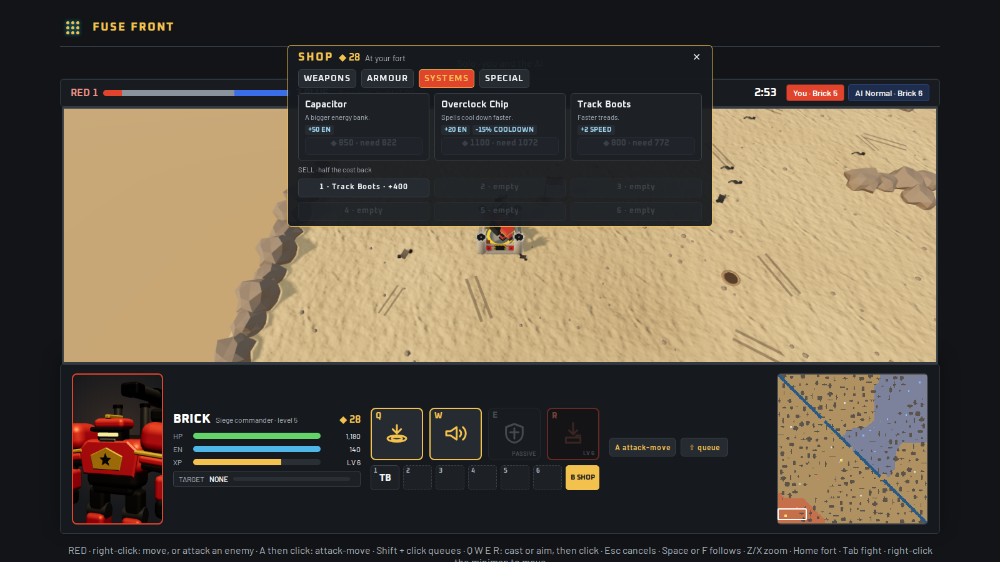

**M4 as built (hero progression, numbers in `tuning.ts`, rules in `hero.ts`).**

- **XP sharing (`award`):** a death's XP goes to the living heroes of the killing team within 10 tiles (`XP_RADIUS`)
  of it, whoever made the kill, so a last hit earns no more XP than standing by. That covers wave units, camp guards,
  heroes and, new, razed lane structures (80, 100 and 120 by tier). With n heroes sharing, each takes
  `(100 + 30 · (n − 1)) / n` percent: 100 alone, 65 each for two, 53 each for three. A kill no seat made pays nobody.
  Capture XP is unchanged.
- **Levels 1–12 (`LEVEL_XP`):** total XP 0, 60, 150, 270, 420, 600, 840, 1,140, 1,500, 1,920, 2,400, 2,940. Every
  level adds its hero profile's hit points and gun damage and 10 energy.
- **Unlocks and ranks (`RANK_TWO`):** the ultimate unlocks at 6 (`ULTIMATE_LEVEL`). A basic spell reaches rank 2 at
  level 9 and an ultimate at 12, and rank 2 casts with 75 percent of the cooldown before items cut it. Passives keep
  growing per level instead. The rank follows from the level, so the checkpoint gains nothing.
- **Respawn:** 4 s plus 4 s a level, at most 40 s (8 s at level 1, 28 s at 6, 40 s from 9). It replaces M2's 2 s per
  match minute, so `respawnSteps` and its checkpoint bound no longer read the step.
- **Comeback (`comebackOf`):** a team that has razed fewer enemy lane structures than the other takes 10 percent more
  XP per structure behind, up to 30. It reads the ruins, so it needs no new state. M3's streak bounty stays.
- **Duels:** a hero's gun does 300 percent to an enemy hero (`HERO.duel`). Robots, towers and spells are unchanged,
  so laning and pushing keep their pace. The roles' stats:

  | Hero  | Role            | HP (+/level)         | Gun (+/level)    | Range | Speed |
  | ----- | --------------- | -------------------- | ---------------- | ----- | ----- |
  | Brick | tank, initiator | 760 (+60), IRON HIDE | 38 (+5)          | 5     | 12    |
  | Vix   | assassin        | 580 (+45)            | 46 (+6), SNIPE   | 7     | 15    |
  | Rivet | support         | 700 (+60)            | 38 (+5)          | 5     | 12    |
  | Tally | scout, mobility | 660 (+50)            | 40 (+5), SPOTTER | 5     | 16    |

  A same-level duel without items takes 4–8 one-second shots at levels 1, 6 and 12 (`tests/progression.test.ts`).
  Vix kills a Vix, Rivet or Tally in 4–6, and Brick takes 6–8 to kill.

- **Bots:** unchanged. M2's structure push stays until M5's MOBA bots replace it.
- **League** (rules `fuse-front-19`, seed 1, normal bots):
  - Neon Duel 1v1: 8.6–22.4 min across all 16 hero pairings, and 9.0–21.6 min in the committed league.
  - Twin Wilds 2v2: 16.9 min. Crown Jungle 3v3: 19.2 min.
  - Heroes reach level 6 by about minute 5, 9–10 by minute 10, and 11–12 by minute 15.
  - The 12 cross pairings on Neon Duel give wins of Vix 6 of 6, Rivet 4, Brick 1 and Tally 1. Vix already won all of
    them before M4. M5's bots and M7's tuning take that on.

**M6 as built (the MOBA HUD).**

- **M6a, structures and the minimap:**
  - **RTS leftovers gone:** the factory orders panel, its buttons and click, and the production clock went, replacing
    the v1 and v2 factory UI described above. M6b, the next PR, adds the scoreboard and the feed. A held
    jungle factory now shows its wave upgrade as a badge in the top bar, such as "+TORCH MID", with a tooltip.
  - **View:** `BuildingView` gains `lane`, `tier` and `shielded`. A factory's `lane` is the lane its upgrade feeds,
    and `shielded` is the engine's no-backdoor rule. `WorldView.campRespawn` gives each camp's steps until its
    guards return, 0 while one stands. These are view-only, so RULES doesn't change.
  - **Minimap** (`minimapMarks`): it draws the lanes, then towers, gates and forts as team squares, hollow once
    razed. Camps show gold, or dim while respawning, with a hover tip giving the time left. Heroes are drawn on top,
    and this device's has a white frame.
  - **Pings:** one of your towers, gates or your fort under fire pings the minimap, at most once per `PING_GAP` per
    structure, through the radar's event dedupe.
  - **Battlefields:** towers, gates and forts always show a health bar, with a blue tag at its left end while
    `shielded`. At the strategic zoom, the 3D field also dots the lane paths and marks the camps.
  - **Phones:** the item row shares its width, so a 390 px screen doesn't scroll sideways.

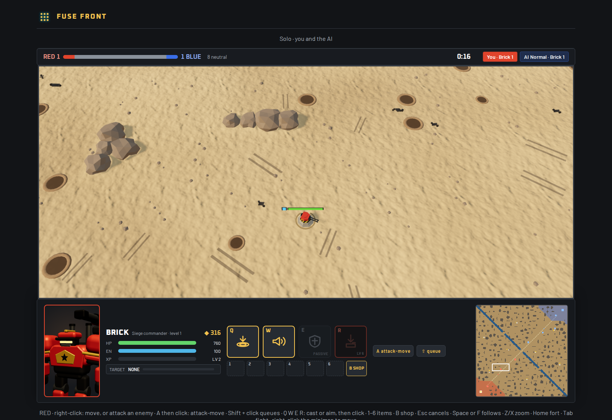
