# Fusetown

_Game id and routes: `fuse-lane`._

You live a week against the clock in Fusetown, a little harbour town with 14 places. You work, study, shop and invest in a town whose economy reacts to what you do. The first player to reach all four goals (wealth, happiness, education and career) in the same week wins; when several get there the same Monday, the one furthest past the goals wins (then the richest). The menu has two tabs:

- **On this device.** Solo against 1–3 AI opponents (easy, normal or hard), or pass and play: 1–4 people share the phone, with or without AI.
- **Play online**, the way Fuse Riders does rooms. Pick your face and name, then **CREATE ROOM**, either **each on their own device** or with a **shared TV** (the screen that creates the room shows the town for everyone, and the phones are the controllers). Friends join with the QR code, the link or the room code; **REJOIN** goes back to the last room. Up to five players, people and AI together.

## The town

Fusetown's streets wind round a town square with a clock tower, past a canal with a footbridge, down to the bay. The places, with where they stand:

- **Roomshare** (where everyone starts and lives at first), **KeyNest** (rent and moving) and **The Tower** along the main road north of the square;
- **FreshCo**, **Neobank**, **Gadget Garage** and **Threads** on the shopping street to the west;
- **Second Life**, **MegaMart** and **Mono Burger** round the market corner in the north-east;
- **Gigafactory** and the **Job Hub** round the square's east side, **City College** above the quay;
- **Fusetown Docks** on the waterfront: the workplace of Fusetown Port, a listed company like the other eight. Its four jobs (Deckhand, Forklift Driver, Crane Operator, Harbour Master) can be applied for at the docks or at the Job Hub, and the Gigafactory also hires at its gate.

## The screen

The town is the picture: the city's map fills the screen, and the game is drawn over it: every player walking the streets (or waiting in front of the place they are in), a glow on the place you are in, walking to or pointing at, and the places' name labels (tap a label or a building to walk there; hovering shows how many hours the walk and the door cost). A slim glass HUD sits on the edges and shows only the hours left with the real seconds left, cash and bank, the four goals, **CALL IT A WEEK**, pause and menu. Everything else opens in the middle of the screen: a place's panel when you walk in (its shopkeeper and its building sticker in the head), the **you** panel (tap the clock: food, clothes, rent, job and this week's private news), the Monday briefing, the **Pass the device** card and the result.

- **Phone (portrait):** the map is as tall as the screen and pans sideways. The camera follows you while you walk; drag to look around (a new walk picks you up again). The clock, money and buttons sit at the top, the goals and CALL IT A WEEK at the bottom. The rivals are on the streets but not on the HUD: their standings (portrait, four goal bars, what they are doing) head every place panel.
- **Wide screen:** the map covers the screen, centred, with one HUD bar along the top and the rivals in the corners (they step aside while a panel is open). A short screen (a phone on its side) pans up and down and shows the rivals in the panels instead.

The town is alive while you play (`src/app/ambience.ts`, looks only): the sun glints on the bay, cloud shadows drift over the roofs, and the light turns golden and then dusky over the last 40 % of your hours. While you walk, a dotted line in your colour shows the rest of the way to the door, and a ring bursts when anyone walks into a place. The cash counts to its new value with a "+$40" rising out of it, a goal ring bumps with "+2" when it grows, and the toast drops in just above the tip. Walking into a place, its keeper pops up and sways, the greeting pops after and the cards follow one by one. Whoever has already played this week (an AI rival, or the person who passed you the phone) walks their week again on the streets beside yours, hour for hour: by your hours or the real seconds gone, whichever is further on. The rules keep each player's walks this week for this (`PlayerState.trail`, looks only). With reduced motion the clouds, glints, pops, bumps and entrances stay still.

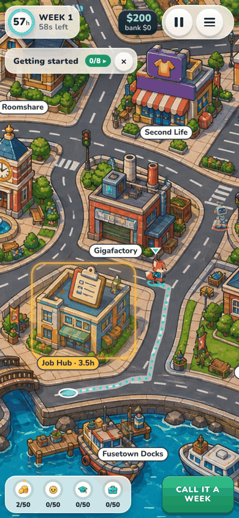 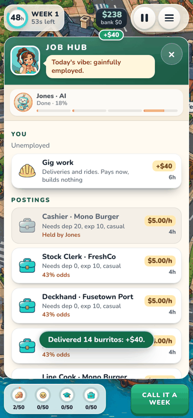 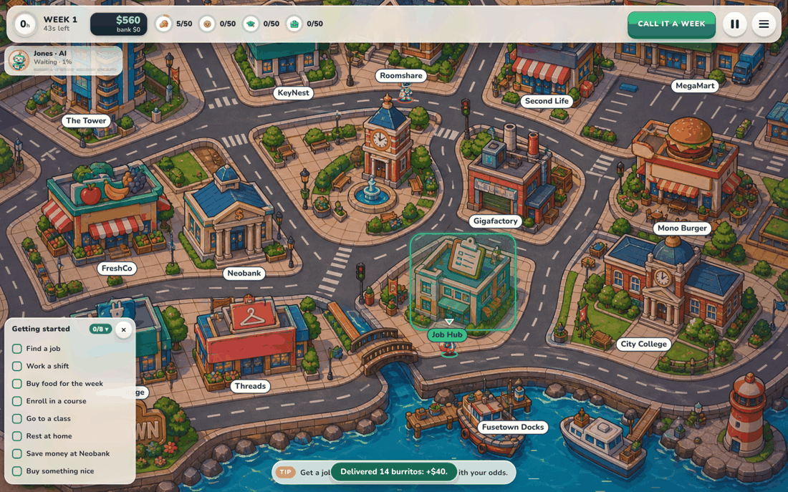

The map never shows an empty edge. `?debug-roads` draws the street graph, the doors and the tap outlines over it.

Cities are data: `src/game/data/cities/fusetown.ts` holds the map's size, the street graph traced over the picture (nodes and bending edges in map pixels), each place's door, tap outline and label, and the parts of the picture that stand in front of the streets. `src/game/streets.ts` cuts the graph into unit steps for the rules, and `src/app/layout.ts` (pure and unit-tested) does the camera, the hit tests and where each player stands. The other city concepts wait in [docs/cities/](docs/cities/) as future city types.

 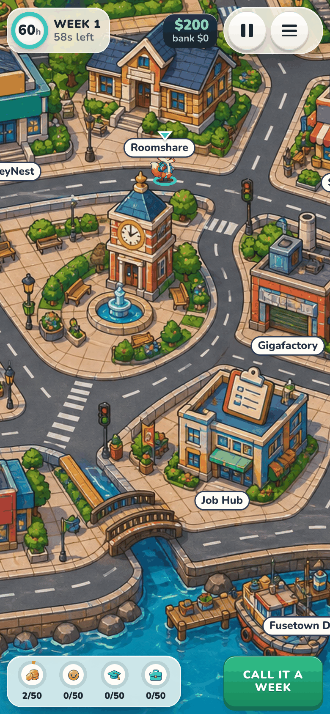 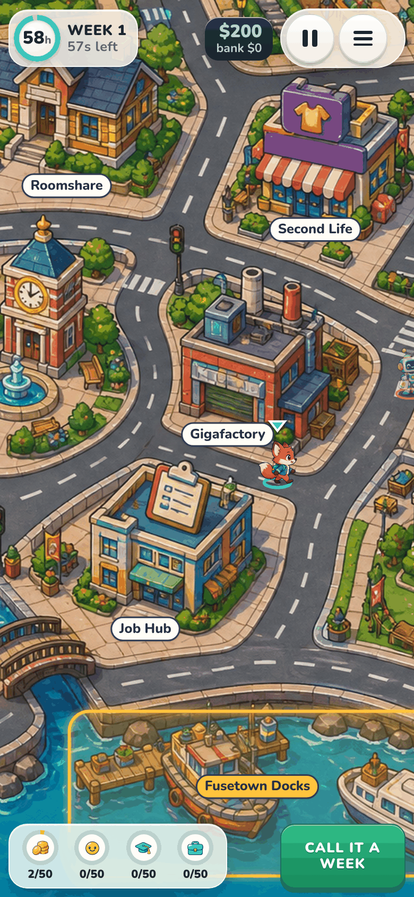 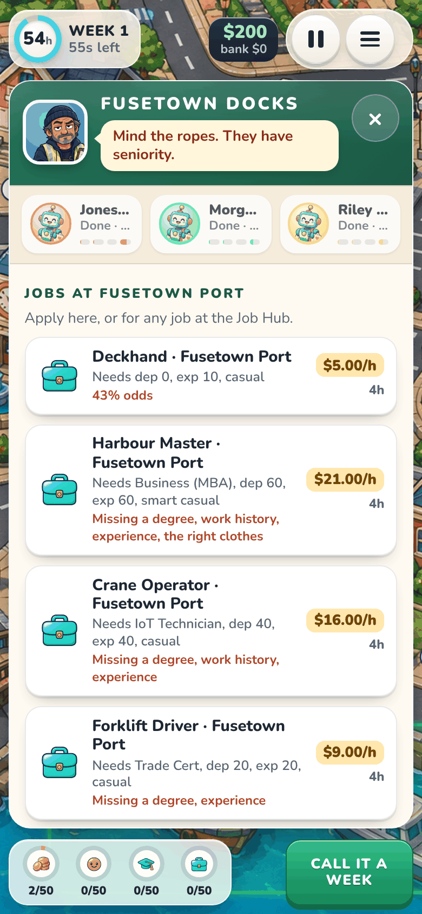 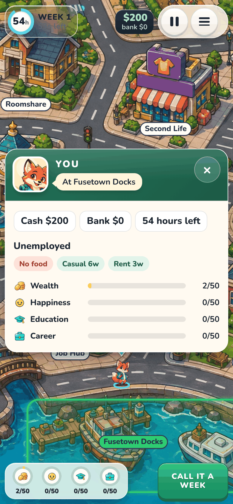 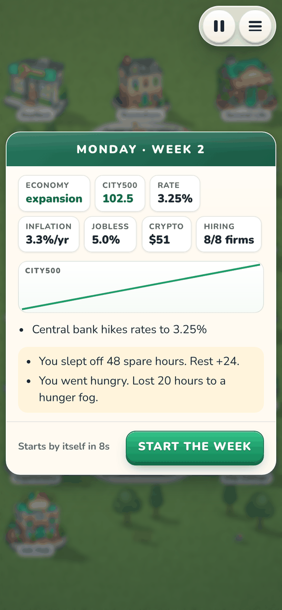 

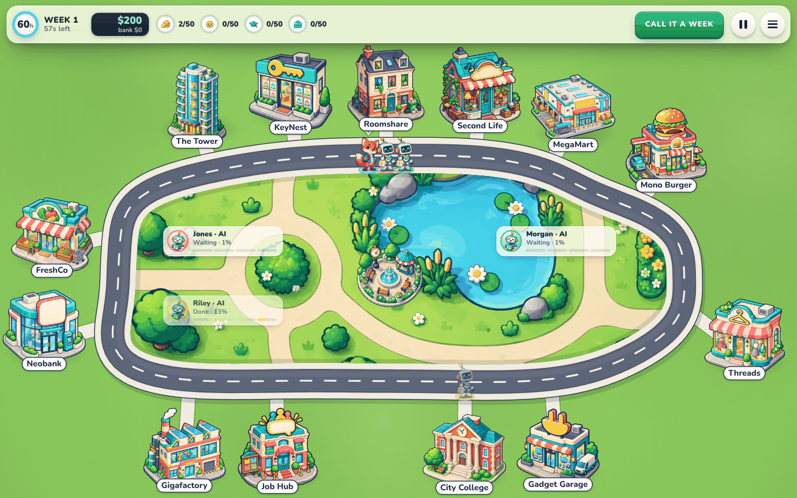

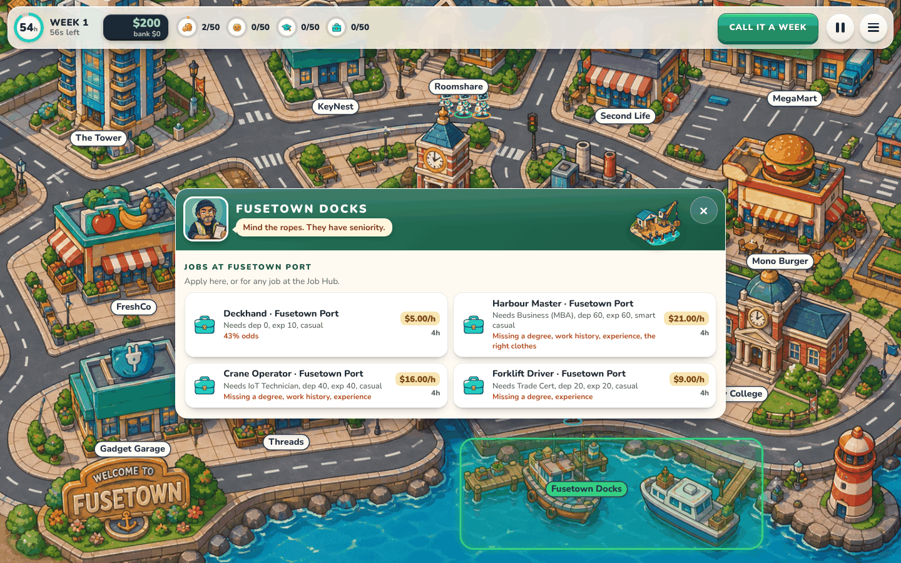

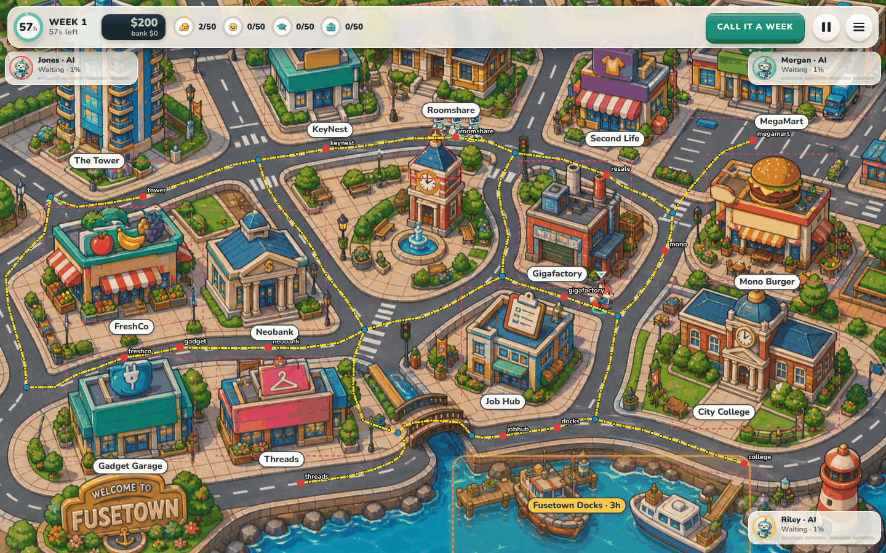

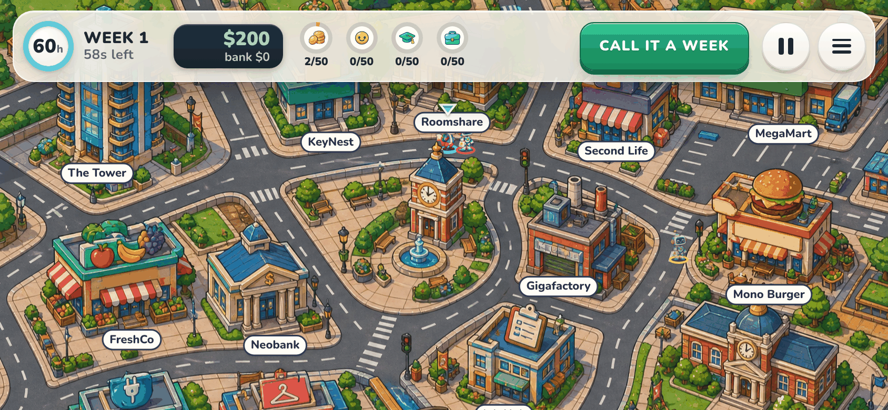 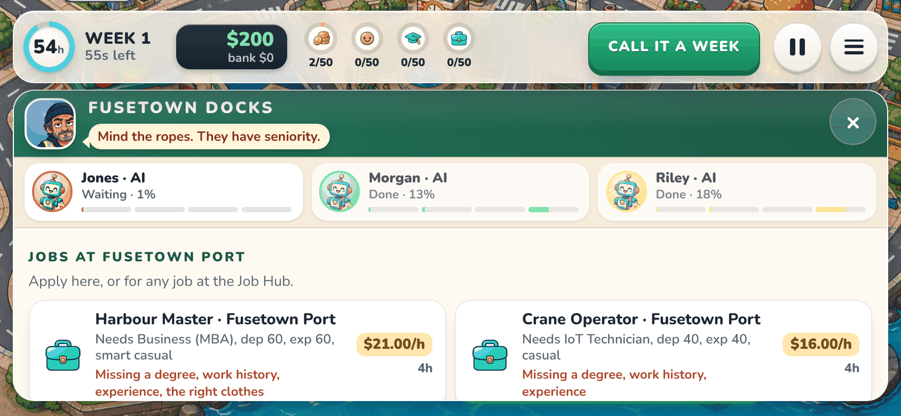

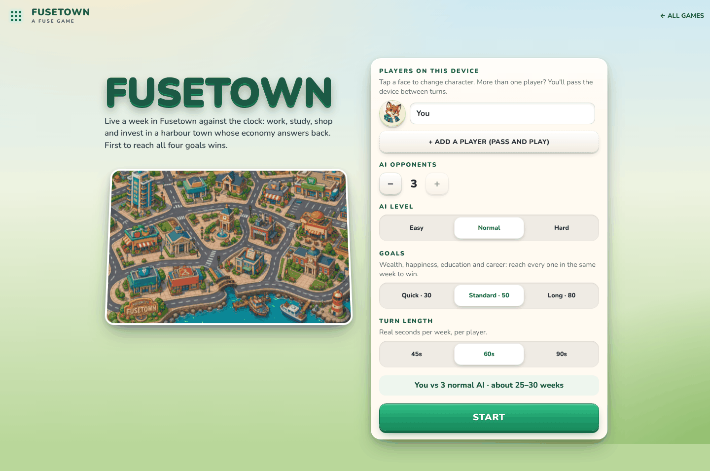 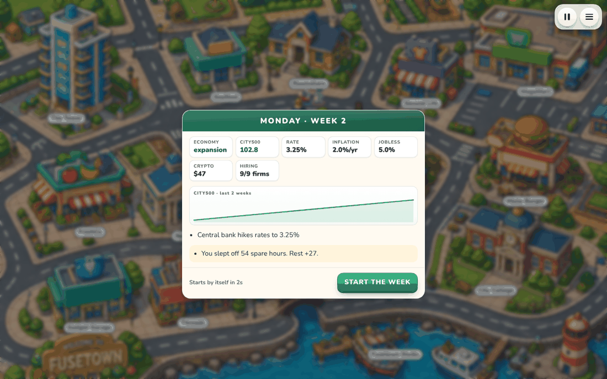 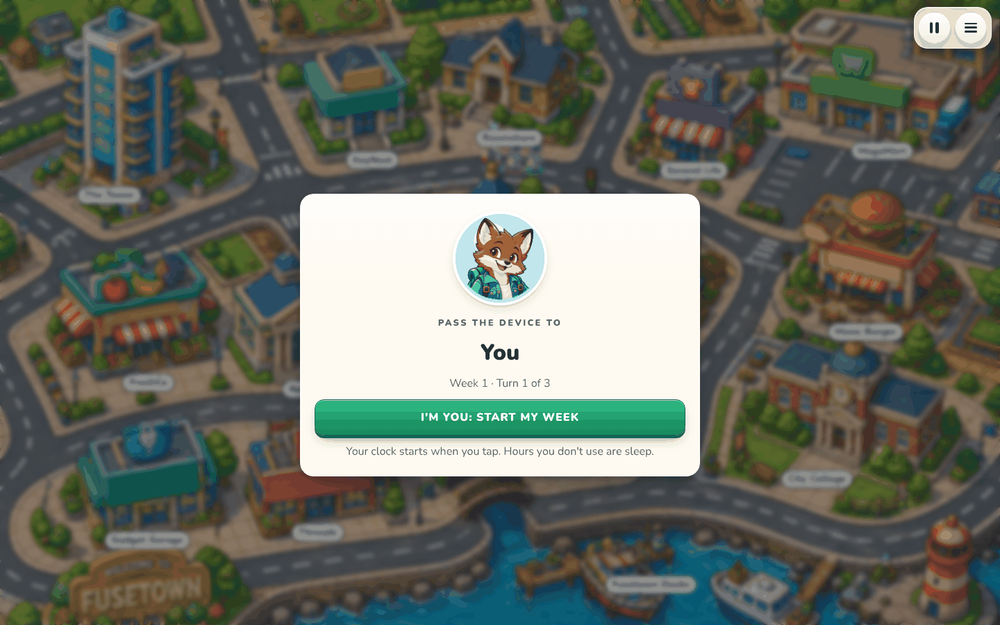

**A static preview:** `pnpm exec vite build --base ./ --outDir /tmp/fuse-preview`, then serve that folder from any path (for example `cd /tmp && python3 -m http.server 8000` and open `http://localhost:8000/fuse-preview/fuse-lane/?mute`). Art and links resolve from where the built script sits, so a relative base works.

## How to play

1. **Menu.** Add the people who will play on this device. Tap a face to change character. Then choose:
   - how many AI opponents, and their level;
   - the goals: Quick 30, Standard 50 or Long 80;
   - the turn length: 45, 60 or 90 real seconds.

   The device remembers your choices. A game in progress is saved on the device, and the menu offers **Continue** next time.

2. **A week** has 60 hours. Tap a building on the board to walk there (keyboards can Tab to a hidden list of the places). You walk the streets the shortest way; it costs 1 hour per 15 steps (the longest walk across town is 86 steps, under 6 hours), and entering a place costs 2 hours. Inside, the place's cards are what you can do there:
   - work a shift: 6 hours, paid as 8;
   - apply for a job: 4 hours for the interview (a posting you are not qualified for, or that turned you down this week, says why at once and costs nothing);
   - attend a class: 6 hours;
   - relax at home: 6 hours;
   - buy food, clothes and goods, or go out for karaoke at Mono Burger (4 hours, once a week);
   - pay rent;
   - save, borrow, or trade shares, bonds, gold and crypto: 1 hour per order or loan. A big order moves the price as it fills, so it pays the average of the price before and after it, plus the spread;
   - buy second-hand goods, pawn your own or redeem them at Second Life;
   - scratch a card at FreshCo ($5, five a week).

   Each card shows its price, its hours and why it is greyed out. **Call it a week** when you are done. Hours you don't use become sleep, which adds to your rest. The real-time clock ends your turn if you forget.

3. **Taking turns.** Everyone plays the same week, one after another:
   - The first player changes every week. The match decides who opens week 1.
   - AI players play their whole week at once when their turn comes.
   - Between people, a full-screen **Pass the device to …** card hides the last player's week. The next player's clock starts only when they tap.
   - Jobs, shelves and market prices are shared. Whoever plays earlier in the week gets first pick: if they take a job, it is gone for everyone after them.
     Online, everyone plays the same week at the same time on their own device, and the rivals walk the streets beside you. The week ends when everyone is done or the clock runs out; until then a line at the bottom says who you are waiting for. Nobody waits for someone who dropped out, and a phone that comes back (a refresh, a tunnel) plays on from where it was. The host picks the AI, their level and the week's length in the lobby; each player picks their own goals (until they do, they play for the first player's). On a shared TV the town fills the screen with a clock, how many are done and everyone's standings in the corners; each phone shows big buttons for the places and opens the place's panel when you get there. **OPEN A TV SCREEN** in the lobby adds a TV to a room of separate devices.
4. **Monday briefing.** You see the economy ticker, the City500 chart and the week's headlines. On a shared device, each player's private news (sleep, hunger, rent, break-ins) opens in their **you** panel on their own next turn. Tap **Start the week**, or the next week starts by itself after 8 s.
5. **Pause** stops the clock. Locking the phone pauses the game too. **Menu** saves the game and quits.
6. **The tour.** The first game on a device opens with a short tour, with the clock stopped, once the first week is on screen. Its cards point at the clock, the goals, the checklist and the tip, and the camera glides to the Job Hub, the Gigafactory, City College, FreshCo, Roomshare and KeyNest, then Neobank and Gadget Garage, saying what each is for (jobs, clothes, study, food, rent, rest and sleep, money). **Skip** ends it. **How to play** on the paused card shows it again.
7. **Tips.** Whenever no place's panel is open, the most pressing next step floats at the bottom of the board (get a job, pay the rent, eat, dress for work, work a shift, apply for a better job, rest, study, treat yourself, save); a tap walks you there. Tap the clock for the first three.
8. **Getting started.** A checklist of first steps sits in a corner of the board: find a job, work a shift, buy food for the week, enroll in a course, go to a class, rest at home, save money at Neobank, buy something nice. Each ticks itself off the first time you do it and stays ticked. A tap on a step walks you there, a tap on the title folds it (it starts folded on a phone held upright), and once all eight are done it says **All set!**. The **×** hides it at any time, and **Show the checklist** in your panel (tap the clock) brings it back. It is kept on the device, per match and player.

**Money and luck.**

- **Loans** at Neobank: a credit line of about four weeks' pay ($200 without a job, $6,000 at most) at the central bank's rate + 12% a year. Each Monday adds a week's interest and takes a tenth of the balance from savings, then cash. A missed payment stops new credit and garnishes half of every shift until a payment is made. What you owe counts against Wealth.
- **Scratch cards** at FreshCo: $5, five a week, pay back about 80% on average; 1 in 1,000 wins $2,000.
- **This week in Fusetown.** Most weeks (7 in 10) bring a town event, headlined in the Monday briefing and shown under the clock all week: a 25% sale at Gadget Garage, MegaMart or Threads; rush pay (+50% a shift) at one employer; City College's open week (tuition half price); the harbour festival (a night out cheers twice as much); a job fair (every employer hires); pickpockets (cash over $200 left unbanked at the weekend may lose 20–40% of the excess, half the time); or flu (rest under 25 risks urgent care at the weekend). Never the same kind two weeks running. Normal and hard bots read the news too.
- **Second Life**, the resale shop: pawn an appliance for 40% of what you paid and redeem it for 50% within three weeks, or it goes on the shelf at 60%. The shelf is shared, first come first served, opens with a used fridge, TV and air fryer and restocks now and then. Used goods break down like budget ones.

**Goals.** Wealth counts cash, savings and investments minus rent owed and loans; Career is capped by the job's rung (a starter job tops out at 30); Education is 11 per degree; Happiness fades a little every Monday (a point per 15), so it needs home comforts, nights out and rest to stay up. Tuition is $110–$340 a course, and asking for a raise after enough experience on the job gives a seniority step (+8%) even at the market wage.

**Rivals.** Each AI opponent has a style, dealt from the match: Steady, Hustler (works a lot), Scholar (studies first, borrows for tuition) or Investor (buys the City500, borrows). Normal and hard bots lean into whichever goal lags. How the numbers were tuned: [docs/balance.md](docs/balance.md).

Weekly upkeep (food, clothes wearing out, rent every 4 weeks, garnishment) and the economy follow the design docs:

- a business cycle;
- a central-bank rate;
- category prices that react to what players spend;
- nine listed companies (Fusetown Port among them) whose health sets wages, hiring freezes and layoffs;
- share prices from earnings;
- spreads and market impact;
- dividends every 12 weeks.

Every coefficient lives in `src/game/data/economy.ts`.

## Layout

| Path                                                                   | What it is                                                                                                                                                                                                                                                                                                                                                                                                                                                                                                  |
| ---------------------------------------------------------------------- | ----------------------------------------------------------------------------------------------------------------------------------------------------------------------------------------------------------------------------------------------------------------------------------------------------------------------------------------------------------------------------------------------------------------------------------------------------------------------------------------------------------- |
| `src/game/`                                                            | The rules: pure, deterministic and DOM-free. `foldTick` folds one 50 ms tick, with the seeded RNG kept in the room. It has two week modes: hot-seat turns (`settings.turns`) and simultaneous play for online rooms.                                                                                                                                                                                                                                                                                        |
| `src/game/data/`                                                       | The 14 places, the 41 jobs and 11 courses, the 30 items, and the economy table. These are our reskinned names and our own lines. `data/cities/` holds the cities as data (only Fusetown for now).                                                                                                                                                                                                                                                                                                           |
| `src/game/streets.ts`                                                  | The city's street graph cut into unit steps: a player's position is a step, and every step knows the distance and the next step to each place's door (built once, deterministically, scaled so the longest trip between two places is about 85 steps).                                                                                                                                                                                                                                                      |
| `src/game/economy.ts`, `week.ts`, `actions.ts`, `bot.ts`               | The economy step, the end of a week, what each action does, and the bot with its three levels and four styles. `credit.ts` holds loans and scratch cards, `resale.ts` Second Life, `data/events.ts` the weekly town events.                                                                                                                                                                                                                                                                                 |
| `src/game/checkpoint.ts`                                               | Encode and fully validate a room. Saves and netcode snapshots both use it.                                                                                                                                                                                                                                                                                                                                                                                                                                  |
| `src/app/local.ts`, `local-runtime.ts`                                 | A match on one device. It runs the same fold with one stream per person, in real time, with pause and save/resume.                                                                                                                                                                                                                                                                                                                                                                                          |
| `src/app/presenter.ts`                                                 | A pure view model built from a frame: HUD, panels as cards, scores, briefing, handoff, result.                                                                                                                                                                                                                                                                                                                                                                                                              |
| `src/app/tour.ts`                                                      | The first-play tour: its cards, what each points at (a HUD piece or places on the map, framed with their labels) and whether this device still owes it. The screen draws it.                                                                                                                                                                                                                                                                                                                                |
| `src/app/tips.ts`                                                      | Tips: what to do next, read from your situation in the bots' order of priorities, each with the place it sends you to.                                                                                                                                                                                                                                                                                                                                                                                      |
| `src/app/checklist.ts`                                                 | The Getting started checklist: its steps, when the player's state shows each done, where each is done, and its save on the device.                                                                                                                                                                                                                                                                                                                                                                          |
| `src/app/layout.ts`                                                    | The board's geometry, pure and tested: how the map covers the screen and how far the camera pans, where panels open, what a tap hits, and where each player walks or stands, for any screen shape.                                                                                                                                                                                                                                                                                                          |
| `src/app/screen.ts`, `board.ts`, `art.ts`, `menu.ts`, `main.ts`        | The page: a full-screen Canvas 2D board (the map scaled once per layout into an offscreen canvas; walkers, glows and labels drawn each animation frame between the two newest frames, with drag to pan and a camera that follows you), the glass HUD, the panels in the middle, the menu and routing.                                                                                                                                                                                                       |
| `src/app/runtime.ts`, `reports.ts`, `session.ts`                       | The online room on fuse-netcode: the runtime, the match reports and which role this page plays (creator, joiner or shared screen).                                                                                                                                                                                                                                                                                                                                                                          |
| `src/app/online-menu.ts`, `room-lobby.ts`                              | The menu's PLAY ONLINE tab (face, name, each device or shared TV, CREATE ROOM, join by code, REJOIN) and a room's lobby (invitation, players, goals, AI level, week length, START).                                                                                                                                                                                                                                                                                                                         |
| `art/assets.ts` → `art/manifest.json`, `art/prompts.md`                | Every raster image the game draws (PNG stickers, and the city map as a JPEG), each with its path under `public/fuse-lane/`, size, anchor, transparency and a generation prompt. Regenerate the two files with `pnpm exec tsx scripts/fuse-lane-art.ts`; `--check` fails when they are stale. Any missing PNG is drawn as a coloured placeholder with a label, so the game is fully playable before the art exists. All 94 images are generated from these prompts and checked in under `public/fuse-lane/`. |
| `tests/`                                                               | Rules, the streets (connected, every door reachable, next steps, trip lengths), economy determinism, checkpoint round trips, rollback over lossy links, hot-seat turns and saves, the board geometry, the presenter and the menu.                                                                                                                                                                                                                                                                           |
| `scripts/fuse-lane-sim.ts`, `scripts/fuse-lane-balance.ts` (repo root) | Headless simulations: `fuse-lane-sim.ts [games] [players] [goal] [turns\|together] [level]` prints where the economy wanders; `fuse-lane-balance.ts --games 300 --level 2 --goal 50` prints match lengths, the last goal reached and each bot style's results ([docs/balance.md](docs/balance.md)).                                                                                                                                                                                                         |

With four bots and goals of 50, a game takes 24–27 weeks (median 25) with hard bots, 25–29 (median 27) with normal ones and 37–55 (median 47) with easy ones; see [docs/balance.md](docs/balance.md).

## Design

The design lives in [andeplane/modern-jones](https://github.com/andeplane/modern-jones/tree/claude/jones-analysis-uhxfts) on branch `claude/jones-analysis-uhxfts`:

- [docs/design/modern-game.md](https://github.com/andeplane/modern-jones/blob/claude/jones-analysis-uhxfts/docs/design/modern-game.md): the game, its places and its milestones.
- [docs/design/economy-sim.md](https://github.com/andeplane/modern-jones/blob/claude/jones-analysis-uhxfts/docs/design/economy-sim.md): the economy model.
- [docs/design/original/](https://github.com/andeplane/modern-jones/tree/claude/jones-analysis-uhxfts/docs/design/original): notes on the original game's numbers. They supplied the hours, wages, prices and requirements; none of the original's text is used.
