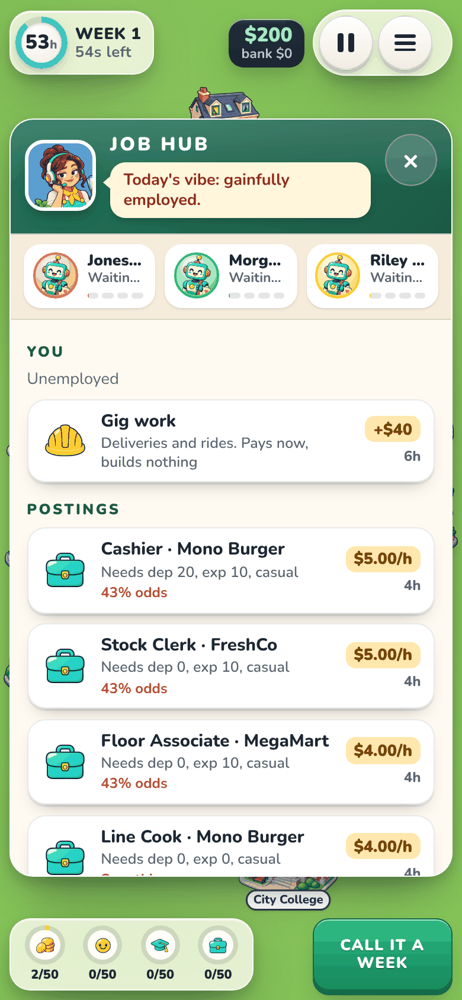
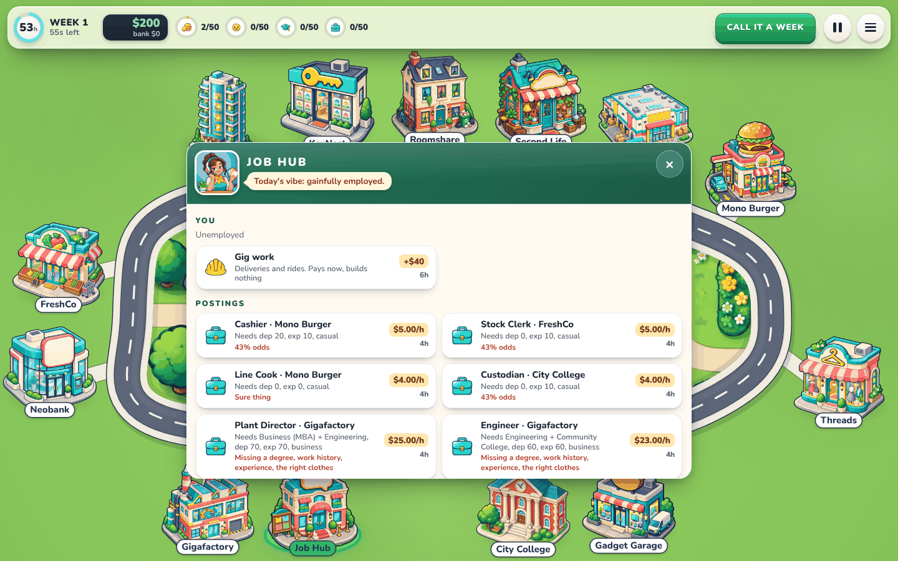

# Fuse Lane

You live a week against the clock on one loop road with 13 places. You work, study, shop and invest in a city whose economy reacts to what you do. The first player to reach all four goals (wealth, happiness, education and career) in the same week wins; when several get there the same Monday, the one furthest past the goals wins (then the richest). The game is played on **one device**:

- **Solo against 1–3 AI opponents.** Their level is easy, normal or hard.
- **Pass and play.** 1–4 people share the phone, with or without AI.

Online rooms still work through a link (`?room=CODE`), but the menu does not offer them for now.

## The screen

The board fills the screen in the soft sticker style of the art set: a smooth, gently bending loop road around the park (the ground picture and the plaza), the 13 places as stickers along the outside of the curve, each on a short path to the sidewalk, and every player walking the inner sidewalk (players at the same door stand side by side). A slim glass HUD sits on the board's edges and shows only the hours left with the real seconds left, cash and bank, the four goals, **CALL IT A WEEK**, pause and menu. Everything else opens in the middle of the board, over the park: a place's panel when you walk in, the **you** panel (tap the clock: food, clothes, rent, job and this week's private news), the Monday briefing, the **Pass the device** card and the result.

- **Phone (portrait):** a tall loop with big buildings. The clock, money and buttons sit at the top, the goals and CALL IT A WEEK at the bottom. The rivals are not on the street: their standings (portrait, four goal bars, what they are doing) head every place panel.
- **Wide screen:** a wide loop, one HUD bar along the top, and the rivals in the park's corners (they step aside while a panel is open).

The geometry is `src/app/layout.ts` (pure and unit-tested): the loop is a squircle with a few slow bends, sampled and walked by arc length, the lots are spread along its outside, and it maps the rules' ring positions onto the drawn street, so each place's ring position lands at its door. It changes nothing in the rules.

     

  

**A static preview:** `pnpm exec vite build --base ./ --outDir /tmp/fuse-preview`, then serve that folder from any path (for example `cd /tmp && python3 -m http.server 8000` and open `http://localhost:8000/fuse-preview/fuse-lane/?mute`). Art and links resolve from where the built script sits, so a relative base works.

## How to play

1. **Menu.** Add the people who will play on this device. Tap a face to change character. Then choose:
   - how many AI opponents, and their level;
   - the goals: Quick 30, Standard 50 or Long 80;
   - the turn length: 45, 60 or 90 real seconds.

   The device remembers your choices. A game in progress is saved on the device, and the menu offers **Continue** next time.

2. **A week** has 60 hours. Tap a building on the board to walk there (keyboards can Tab to a hidden list of the places). Walking costs 1 hour per 15 steps and entering a place costs 2 hours. Inside, the place's cards are what you can do there:
   - work a shift: 6 hours, paid as 8;
   - apply for a job: 4 hours;
   - attend a class: 6 hours;
   - relax at home: 6 hours;
   - buy food, clothes and goods;
   - pay rent;
   - save, or trade shares, bonds, gold and crypto: 1 hour per order. A big order moves the price as it fills, so it pays the average of the price before and after it, plus the spread.

   Each card shows its price, its hours and why it is greyed out. **Call it a week** when you are done. Hours you don't use become sleep, which adds to your rest. The real-time clock ends your turn if you forget.

3. **Taking turns.** Everyone plays the same week, one after another:
   - The first player changes every week. The match decides who opens week 1.
   - AI players play their whole week at once when their turn comes.
   - Between people, a full-screen **Pass the device to …** card hides the last player's week. The next player's clock starts only when they tap.
   - Jobs, shelves and market prices are shared. Whoever plays earlier in the week gets first pick: if they take a job, it is gone for everyone after them.
4. **Monday briefing.** You see the economy ticker, the City500 chart and the week's headlines. On a shared device, each player's private news (sleep, hunger, rent, break-ins) opens in their **you** panel on their own next turn. Tap **Start the week**, or the next week starts by itself after 8 s.
5. **Pause** stops the clock. Locking the phone pauses the game too. **Menu** saves the game and quits.

Weekly upkeep (food, clothes wearing out, rent every 4 weeks, garnishment) and the economy follow the design docs:

- a business cycle;
- a central-bank rate;
- category prices that react to what players spend;
- eight listed companies whose health sets wages, hiring freezes and layoffs;
- share prices from earnings;
- spreads and market impact;
- dividends every 12 weeks.

Every coefficient lives in `src/game/data/economy.ts`.

## Layout

| Path                                                            | What it is                                                                                                                                                                                                                                                                                                                                                                                                                                                                     |
| --------------------------------------------------------------- | ------------------------------------------------------------------------------------------------------------------------------------------------------------------------------------------------------------------------------------------------------------------------------------------------------------------------------------------------------------------------------------------------------------------------------------------------------------------------------ |
| `src/game/`                                                     | The rules: pure, deterministic and DOM-free. `foldTick` folds one 50 ms tick, with the seeded RNG kept in the room. It has two week modes: hot-seat turns (`settings.turns`) and simultaneous play for online rooms.                                                                                                                                                                                                                                                           |
| `src/game/data/`                                                | Places and the ring road, the 37 jobs and 11 courses, the 30 items, and the economy table. These are our reskinned names and our own lines.                                                                                                                                                                                                                                                                                                                                    |
| `src/game/economy.ts`, `week.ts`, `actions.ts`, `bot.ts`        | The economy step, the end of a week, what each action does, and the bot with its three levels.                                                                                                                                                                                                                                                                                                                                                                                 |
| `src/game/checkpoint.ts`                                        | Encode and fully validate a room. Saves and netcode snapshots both use it.                                                                                                                                                                                                                                                                                                                                                                                                     |
| `src/app/local.ts`, `local-runtime.ts`                          | A match on one device. It runs the same fold with one stream per person, in real time, with pause and save/resume.                                                                                                                                                                                                                                                                                                                                                             |
| `src/app/presenter.ts`                                          | A pure view model built from a frame: HUD, panels as cards, scores, briefing, handoff, result.                                                                                                                                                                                                                                                                                                                                                                                 |
| `src/app/layout.ts`                                             | The board's geometry, pure and tested: the street loop, the building lots (each place keeps its order around the loop), the park and where panels open, for any screen shape.                                                                                                                                                                                                                                                                                                  |
| `src/app/screen.ts`, `board.ts`, `art.ts`, `menu.ts`, `main.ts` | The page: a full-screen Canvas 2D board (the flat ground, road and park cached offscreen per layout; buildings and walkers drawn each animation frame between the two newest frames), the glass HUD, the panels in the board's middle, the menu and routing.                                                                                                                                                                                                                   |
| `src/app/runtime.ts`, `reports.ts`, `session.ts`                | The online room on fuse-netcode, kept working but not in the menu.                                                                                                                                                                                                                                                                                                                                                                                                             |
| `art/assets.ts` → `art/manifest.json`, `art/prompts.md`         | Every raster PNG the game draws, each with its path under `public/fuse-lane/`, size, anchor, transparency and a generation prompt sharing one style. Regenerate the two files with `pnpm exec tsx scripts/fuse-lane-art.ts`; `--check` fails when they are stale. Any missing PNG is drawn as a coloured placeholder with a label, so the game is fully playable before the art exists. All 93 PNGs are generated from these prompts and checked in under `public/fuse-lane/`. |
| `tests/`                                                        | Rules, economy determinism, checkpoint round trips, rollback over lossy links, hot-seat turns and saves, the presenter and the menu.                                                                                                                                                                                                                                                                                                                                           |
| `scripts/fuse-lane-sim.ts` (repo root)                          | A headless balance simulation: `pnpm exec tsx scripts/fuse-lane-sim.ts [games] [players] [goal] [turns\|together] [level]`.                                                                                                                                                                                                                                                                                                                                                    |

With four hard bots and goals of 50, a game takes 24–31 weeks (median 26) in both week modes. Two normal bots take about 32 weeks; two easy bots take 41–55 weeks with goals of 30.

## Design

The design lives in [andeplane/modern-jones](https://github.com/andeplane/modern-jones/tree/claude/jones-analysis-uhxfts) on branch `claude/jones-analysis-uhxfts`:

- [docs/design/modern-game.md](https://github.com/andeplane/modern-jones/blob/claude/jones-analysis-uhxfts/docs/design/modern-game.md): the game, its places and its milestones.
- [docs/design/economy-sim.md](https://github.com/andeplane/modern-jones/blob/claude/jones-analysis-uhxfts/docs/design/economy-sim.md): the economy model.
- [docs/design/original/](https://github.com/andeplane/modern-jones/tree/claude/jones-analysis-uhxfts/docs/design/original): notes on the original game's numbers. They supplied the hours, wages, prices and requirements; none of the original's text is used.
