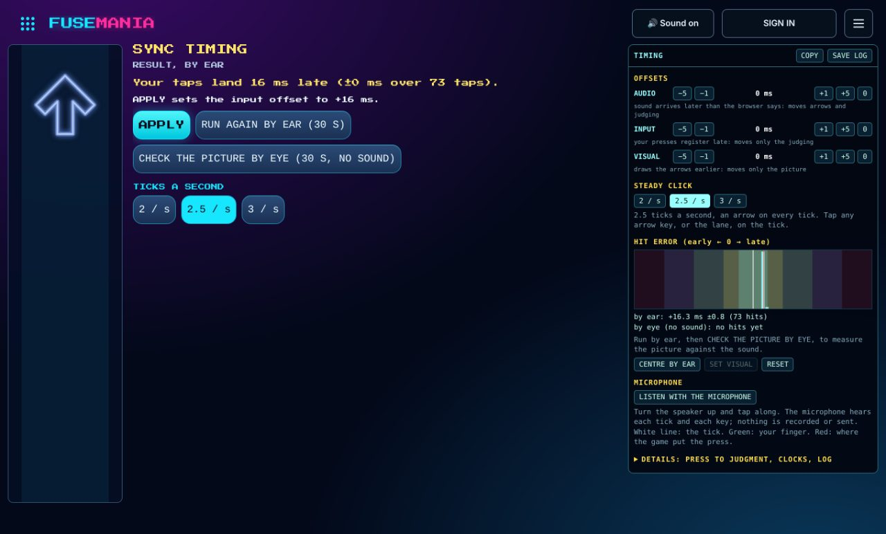

# Fusemania: where lag comes from, and what the page can measure

A rhythm game has three clocks to line up: when the player **hears** the beat, when they **see** the arrow on its target, and when the game thinks they **pressed**. This note walks the chain from a finger to a judgment, says which parts the page measures, which it cannot, and how the game deals with each.

## The short answer

- **Key press detected until detected in game** is measurable and measured: the browser stamps the event (`event.timeStamp`), and the page records how long after that its listener ran and how long until the next frame. That delay does **not** move a judgment, because the judge uses the stamp, not the time the listener ran.
- **Before the browser's stamp** (the switch, USB or Bluetooth polling, the operating system) and **after the page hands over a frame or a sample** (compositor, display, Bluetooth audio the browser does not know about) cannot be seen from a page. They can only be measured through the player: by tapping to a click (**CALIBRATE**) or from the errors of a played song (the result's offer).
- So the design is: stamp everything on the audio clock, measure what is measurable, and fold everything else into three numbers per device: the **audio offset** (sound that arrives later than the browser says), the **input offset** (presses that register late) and the **visual offset** (a picture that arrives late). The game offers to correct the input offset when a song shows a clear bias.
- **Sync timing** in the main menu (`?timing`) is the place to find out which of the three a device needs: thirty seconds of a steady tick, then one line on what to do and one button. Its panel has the offsets, a microphone that hears the tick and the key, and a log of the session. See **Sync timing** below.

## The chain

| Stage                                                 | Typical size                                                                         | Seen by the page?                                | What the game does                                                                                                                                                                                                                                                                                   |
| ----------------------------------------------------- | ------------------------------------------------------------------------------------ | ------------------------------------------------ | ---------------------------------------------------------------------------------------------------------------------------------------------------------------------------------------------------------------------------------------------------------------------------------------------------- |
| Key switch travel and debounce                        | 1 to 30 ms, fixed per keyboard                                                       | No                                               | Input offset                                                                                                                                                                                                                                                                                         |
| USB polling (125 Hz default, 1000 Hz gaming)          | 0 to 8 ms, or 0 to 1 ms                                                              | No                                               | Input offset (the average), jitter stays                                                                                                                                                                                                                                                             |
| Bluetooth keyboard                                    | 7.5 to 30 ms connection interval, more when it sleeps                                | No                                               | Input offset, jitter stays                                                                                                                                                                                                                                                                           |
| Operating system input queue to the browser           | around 1 ms, more under load                                                         | No (it is before the stamp on most browsers)     | Input offset                                                                                                                                                                                                                                                                                         |
| Touch: digitizer scan (60 to 240 Hz) and touch filter | 4 to 16 ms plus the system's processing; a finger also lands later than it "presses" | No                                               | Input offset; touch is its own device, so calibrate on it                                                                                                                                                                                                                                            |
| **Browser stamp to listener** (main thread queue)     | under 1 ms idle; a long frame or a garbage collection adds its length                | **Yes**: `press > handler`                       | Nothing to correct: the judge uses `event.timeStamp`, so this delay does not reach the judgment                                                                                                                                                                                                      |
| **Listener to next frame**                            | 0 to one frame (16.7 ms at 60 Hz, 6.9 ms at 144 Hz)                                  | **Yes**: `press > frame`, `press > drawn`        | Only the flash is late, never the judgment                                                                                                                                                                                                                                                           |
| Stamp on the page clock to the audio clock            | under 0.2 ms with the browser's clock pair; under about 1 ms on the stepped clock    | **Yes**: `clock pair jitter`, `audio clock step` | `song-clock.ts` reads `AudioContext.getOutputTimestamp()`, a sample position and the page-clock time it leaves the device taken at one instant, and converts every stamp with it. Where a browser has none, it keeps a smoothed `audio clock − performance.now()` and takes the reported latency off |
| Audio: Web Audio graph (`baseLatency`)                | 3 to 12 ms                                                                           | **Yes**, as reported by the browser              | Used only where `outputLatency` is not reported. Where it is, the game takes `outputLatency` alone, so if a browser's figure leaves the graph's share out, those few ms end up in the input offset                                                                                                   |
| Audio: OS mixer and device (`outputLatency`)          | 5 to 40 ms wired; 100 to 300 ms Bluetooth                                            | **Partly**: only what the browser is told        | Taken off the song position, so arrows are drawn where the heard song is. Whatever the browser under-reports is the **audio offset**: it is counted as more latency, so the song starts that much earlier and the picture and the judging move together                                              |
| Frame handed over to light from the screen            | 1 to 3 frames of compositor and scan-out, plus the panel (TVs: 20 to 100 ms)         | No                                               | A frame is drawn for one refresh after its timestamp (the soonest its pixels can show), measured from the frame intervals. The rest is the visual offset; the Sync timing screen measures it through the player (hits by eye against hits by ear)                                                    |
| The player                                            | people tap 10 to 50 ms **ahead** of a steady beat, some behind                       | Only through their hits                          | Input offset                                                                                                                                                                                                                                                                                         |
| Network (rooms)                                       | tens of ms                                                                           | Yes, and irrelevant                              | A press travels with its song time and is judged at that time on every device. See **The network cannot move a judgment**                                                                                                                                                                            |
| Phone as a pad for the shared TV                      | the TV's audio and video delay plus the two devices' room-clock difference           | No                                               | The pad stamps taps with the room clock, since it makes no sound. Its input offset has to cover the TV; CALIBRATE on the phone does not measure that (the click comes from the phone), and the result's offer is not shown on a pad either                                                           |

### What `event.timeStamp` is

`event.timeStamp` is a time on the same clock as `performance.now()`. In Chromium and Firefox it is taken from the operating system's input event, before the event waits for the page's main thread, so it is the closest a page gets to the moment of the press. Browsers coarsen it (Chromium to 0.1 ms, Firefox and Safari to 1 ms; Firefox with fingerprinting resistance to much more), which is small beside a 22 ms Marvelous window. Safari's behaviour is the one I could not confirm from here: if a browser stamps at dispatch rather than at the OS event, `press > handler` reads near zero and the queueing delay moves, unseen, into the input offset.

The page never trusts a stamp blindly: one that is zero or more than half a second from now (a synthetic event, a browser that stamps on another clock) is replaced by the time the listener ran, and the probe counts those (`without a usable stamp`).

### Judging uses the stamp

This was already so before this note, and is now covered by the probe: `main.ts` converts `event.timeStamp` with `songClock.songMs(stamp)` (keys and touch pads alike), takes the input offset off, and logs the press with that song time. The fold judges at that time, not at the room tick and not at the time the listener ran. A frame that takes 40 ms therefore delays the flash by 40 ms and the judgment by nothing.

## Measuring it

Add `?latency` to a solo or room URL (for example `/fusemania/?solo=1&latency`) for an overlay, or call `fusemania.latency()` / `fusemania.latencyText()` in the console on any Fusemania room page. It reports p50, p95, p99 and the largest of the newest 600 samples:

| Line                   | Meaning                                                                                                                                                                                                                                   |
| ---------------------- | ----------------------------------------------------------------------------------------------------------------------------------------------------------------------------------------------------------------------------------------- |
| `press > handler`      | Listener start minus `event.timeStamp`: the wait for the main thread                                                                                                                                                                      |
| `press > frame`        | Start of the next animation frame minus the stamp: the soonest the press can be drawn                                                                                                                                                     |
| `press > drawn`        | End of that frame's drawing minus the stamp: the picture is handed to the browser                                                                                                                                                         |
| `frame interval`       | Between animation frames: the display's refresh, and dropped frames in the tail                                                                                                                                                           |
| `frame work`           | Time the frame's own work took                                                                                                                                                                                                            |
| `frame start lag`      | Frame callback start minus the frame's timestamp                                                                                                                                                                                          |
| `audio clock step`     | Distance of each raw audio clock reading from the smoothed mapping. A reading is the clock's last step (2.7 to 2.9 ms per render quantum, 10 ms and more on some browsers), so this is mostly the step size. It does not reach a judgment |
| `clock pair jitter`    | How far each new clock pair lands from the mapping in use: the error a stamp's conversion can carry. `-` where the browser has no pair                                                                                                    |
| `audio base latency`   | `AudioContext.baseLatency`                                                                                                                                                                                                                |
| `audio output latency` | `AudioContext.outputLatency`, or "not reported" (Safari, and any browser before its context has run)                                                                                                                                      |
| `hit error`            | This song so far: mean and scatter of the player's signed errors, the same numbers the result's offer uses                                                                                                                                |

`scripts/fusemania-latency.ts` plays a song with real browser key events a chosen distance from every note and prints the overlay and the result's offer. With `LAB=1` it drives a run on the Sync timing screen instead (`RATE` for the ticks a minute, `MUTE=1` for a run by eye, `APPLY=1` to press APPLY and print what was stored), and with `MIC=1` it adds the microphone through a loopback of the page's own sound with known delays.

## The three offsets

| Offset     | Range   | Moves                               | For                                                                                      |
| ---------- | ------- | ----------------------------------- | ---------------------------------------------------------------------------------------- |
| **Audio**  | ±500 ms | The song itself: arrows and judging | Bluetooth headphones, a TV or soundbar: sound arriving later than `outputLatency` admits |
| **Input**  | ±150 ms | Judging only                        | A slow keyboard or touch screen, and the player's own habit of tapping ahead of the beat |
| **Visual** | ±200 ms | The picture only                    | A slow display: the arrows are drawn that much earlier                                   |

The audio offset is new. Before it, a Bluetooth lag of 250 ms went into the input offset, which only moved the judging: the arrows still met their targets a quarter of a second before the sound did. As audio latency it moves both, and the song is started earlier so the room stays in step. **CALIBRATE** places what it measures: under 80 ms goes to the input offset, more goes to the audio offset. A stored input offset beyond 150 ms from before this change is moved to the audio offset the first time the page loads.

## The network cannot move a judgment

A press is logged with its own song time (`event.timeStamp` on the audio clock, offsets taken off), and every device judges it at that time. The one thing the room clock does is bound it: `applyInput` clamps a press's song time to within 300 ms before and 150 ms after the tick it was logged for, so that a device cannot claim a press from another second. A press sits about 150 ms inside those bounds in ordinary play (158 ms at the least in the runs below) and the song is realigned if it drifts 120 ms from the room clock, so the bounds are not reached. The exception was a large input offset: 300 ms of it pushed every press onto the bound, where it was judged late and in 50 ms steps. That is why the input offset now stops at 150 ms and large lags go to the audio offset, which moves the song instead of the press.

The panel of a `?debugtiming` game shows this live: `room clock: moved 0 of N presses (least room M ms)`. `tests/runtime.test.ts` holds it down: a press keeps its song time and judgment whether it is logged at once or 200 ms late.

## Sync timing



**Sync timing** in the main menu (`/fusemania/?timing`, or `?sync`) is a screen of its own for setting the offsets. It is not a game: there is no song, chart, score or room, only a tick and one lane of arrows.

A run is four lead-in ticks and then thirty seconds of a steady tick (2, 2.5 or 3 a second), tapped on any arrow key or on the lane. The tick is made in the page from the same numbers the taps are counted with (`src/app/click-track.ts`), and one short lap of it is started again and again on the audio clock (`src/app/tick-loop.ts`), so tick `n` leaves the context at exactly `origin + n × beat`: there is no chart or encoder error to wonder about. When the run ends the screen says what it measured, what to do, and offers **APPLY** (`src/app/timing-advice.ts`):

- **START BY EAR.** The tick is heard. The centre of the taps is the whole lag between the sound and the press: under 80 ms it goes to the input offset, more goes to the audio offset. Within 3 ms of where the offsets already are, the screen says there is nothing to change.
- **CHECK THE PICTURE BY EYE.** The tick is silent and only the arrows are followed. What the taps by eye are later than the taps by ear is the picture's, and goes to the visual offset: the same player and keyboard, so the difference is the display.
- Fewer than eight taps, or taps spread 40 ms or more, are no measurement, and the screen asks for another run. A lag near half a tick can belong to the tick before, and the advice says to check it at 2 ticks a second.
- A run is stopped with Escape or **STOP**, and aborted with a message when the sound stops under it or the tick cannot be loaded.

Two runs by the same player differ by several ms (7 ms on the MacBook below), so a difference that small between runs is the player, not the device.

Beside the run is a panel:

- **Offsets.** The three knobs in steps of 1 and 5 ms, applied at once.
- **Hit error.** A histogram of this session's signed errors over the judgment windows, by ear and by eye, with **CENTRE BY EAR** and **SET VISUAL** doing by hand what APPLY does.
- **Microphone.** See below.
- **Details** (open with `?timing&debugtiming`): the probe's table, a histogram of press to frame, the last presses one by one, and the clocks: which mapping is in use, how far the heard position is behind the audio clock against what the browser reports, the display's refresh and the frame lead.
- **COPY** puts all of it on the clipboard as text. **SAVE LOG** downloads the session.

`?debugtiming` on a room or solo URL shows the same panel beside a real game, in a column of its own, with the room-clock lines added and a button to the Sync timing screen. `?audioclock=reported` plays on the stepped clock and the reported latency instead of the clock pair, to compare the two on one device.

### The microphone

**LISTEN WITH THE MICROPHONE** asks for the microphone (only ever from that button) with echo cancelling, noise suppression and gain control off. Nothing is recorded, stored or sent: the samples are reduced on the spot to two loudness envelopes of the last eight seconds, one around the tick's 6 kHz and one where a key's thud is, in quarter-millisecond bins on the audio clock's own frame count.

Start a run by ear with the tick on the **speakers** and tap along on the keyboard. The microphone hears each tick and each key:

- **finger vs tick (microphone)** is when the key sounded against when the tick sounded. Both went through the same microphone, so its delay cancels. This is what the player really did.
- **press vs tick (game)** is what the game made of the same press.
- **game − microphone** is therefore the device's error that the offsets do not yet cover: keyboard, operating system, stamp, and any audio delay the browser did not report. The player's habit of tapping early is in both and drops out. **APPLY** puts it into the offsets (the audio offset when it is large).
- **input path jitter** is the scatter of the stamp against the key's sound: how evenly the keyboard and the browser deliver presses.

Limits: the key is heard when it bottoms out, a few ms after the switch closes, so a result within a few ms of zero is as good as this gets. Headphones do not work (the microphone cannot hear them) unless an earpiece is held to it. A wireless headset's own microphone is late, narrow and far from the keyboard, so the screen picks another microphone when there is one. Touch screens make no sound to hear. The browser may leave some processing on although asked not to; the panel says so when it does.

### The session file

Everything above is also a log of JSON lines: the session's device and settings, every press (stamp, listener, frame, song time, slack to the tick bounds, judgment), clock readings once a second, offset changes, every tick and key the microphone heard, a summary every five seconds, and for the Sync timing screen a `run` line when a run starts and a `result` line when it ends, with the advice and every tap in ms from the first counted tick. On a local dev server (`pnpm dev`, or `pnpm exec tsx service/dev.ts`) the page posts it to `/api/dev/timing-log` and the server appends it to `timing-logs/fusemania-<session>.jsonl` in the repository, where whoever debugs the timing next (a person or an agent) can read the whole session. The deployed service has no such route and the page does not ask it; there, **SAVE LOG** downloads the same file. A phone on the same network is served by the dev server only when its origin is allowed (`--allow-origin http://<address>:<port>`), and the log with it; the panel says when the server took none. Names in the log are the song and the browser; no player names, room codes or audio.

### Measured here

`ONLINE_URL=http://localhost:8890/ SECONDS=30 pnpm exec tsx scripts/fusemania-latency.ts` on the revision that added this note: headless Chromium in a cloud container, Arcade Adventure on Medium, 56 keys sent 18 ms before their notes through the browser's own input path.

```
ms                   p50    p95    p99    max
press > handler      0.6    5.0    5.8    5.8  n=56
press > frame        8.7   14.9   16.1   16.1  n=56
press > drawn        9.2   15.5   16.4   16.4  n=56
frame interval      16.7   16.8   16.8   16.8  n=600
frame work           0.4    0.8    2.2    5.5  n=600
frame start lag      0.5    3.8    4.9    7.4  n=600
audio clock jitter   4.7    9.1    9.8   10.6  n=600
audio base latency  10.0 ms
audio output latency  32.0 ms
presses: 56 key, 0 touch, 0 without a usable stamp
hit error: −15.1 ±1.9 ms over 47 steps (input offset 0 ms)
```

Reading it: the listener ran 0.6 ms after the browser's stamp at the median and 6 ms at worst, and a press reached a frame within one frame (8.7 ms median, 16 ms worst at 60 Hz). The same run on a whole song with the unit tests using every core beside it put `press > handler` at 2.2 ms median, 13.7 ms p95 and 27 ms worst, and the judgments did not move: all 118 steps were judged Marvelous at the same 16 ms early, and the result offered −16 ms. That is the stamp doing its job. The keys were sent 18 ms early and read as 15 to 16 ms early, so about 2 to 3 ms went into getting the key from the test process into the browser, which is the part before the stamp that the page cannot see. The audio clock here steps coarsely (jitter of 5 to 10 ms, an audio device that does not exist); the smoothed mapping is what keeps that out of the judgments.

These are a cloud container's figures: no display, no audio device, and keys injected into the browser rather than typed. They show that the page's own share is small and that the stamp, not the handling time, carries the judgment. They say nothing about a keyboard, a screen or a pair of headphones; the overlay on the device in question does, for the rows it can see.

### Measured with the microphone

`LAB=1 MIC=1 SECONDS=16 ONLINE_URL=http://localhost:8890/ pnpm exec tsx scripts/fusemania-latency.ts`, same container, the tick at 2.5 a second, 31 keys sent 18 ms before their ticks. (The table is from the revision where the tick was still a click-track song; on the Sync timing screen the same command over 12 seconds heard 33 of 33 ticks and 29 of 29 keys, advised −17 ms and put game − microphone at +20.2 ±0.2 ms.) The microphone is a loopback the script puts in the page: the page's sound delayed 50 ms like a speaker, and a thud 12 ms before each key's stamp like a keyboard. The song clock should therefore be found 62 ms short, less the latency it already counts.

|                                    | Clock pair                 | `?audioclock=reported` |
| ---------------------------------- | -------------------------- | ---------------------- |
| Heard position behind audio clock  | 41.2 ms                    | 32.0 ms (as reported)  |
| Hit error                          | −13.6 ±1.2 ms              | −8.9 ±0.6 ms           |
| Clock pair jitter, p50 / p95 / max | 0.0 / 0.1 / 1.1 ms         | none                   |
| Audio clock step, p50 / p95 / max  | 4.7 / 8.9 / 10.1 ms        | 4.5 / 8.9 / 11.0 ms    |
| Ticks heard                        | 40 of 40, ±0.1 ms          | 39 of 39, ±0.1 ms      |
| Keys heard                         | 31 of 31                   | 31 of 31               |
| game − microphone                  | +20.4 ±0.3 ms              | +29.5 ±0.1 ms          |
| Expected (62 − counted latency)    | +20.8 ms                   | +30.0 ms               |
| Presses moved by the room clock    | 0 of 31, least room 158 ms | 0 of 31                |

So the microphone finds a known error to within a millisecond or two through the real capture path (four more runs gave +19.4 to +20.4 against +20.5 to +21.5 expected), and the two mappings differ by exactly the 9 ms of output delay that this browser's `outputLatency` leaves out and its clock pair includes.

On a MacBook (Chrome 157, 120 Hz display, a silent context on the live site, so no keys and no sound): `outputLatency` 168 ms and steady, the audio clock advancing 5.3 or 10.7 ms at a time with a reading up to 5.3 ms stale, the clock pair holding within 0.17 ms from frame to frame and putting the output 176 ms behind the clock, 8 ms more than `outputLatency` says. Those 8 ms were in every judgment before the clock pair was used.

On the same MacBook with a person tapping (speakers, built-in keyboard, 2.5 ticks a second, input offset +27 ms): one run by ear centred on 26.7 ms (±11 ms over 72 taps, nothing to change) and the next, five minutes later, on 33.6 ms (±10 ms over 71 taps, +34 offered). Each run's centre is good to about 2 ms, so the 7 ms between them is the player from run to run; the two together say +30 ms.

## What cannot be measured in software

- **Display latency.** No web API reports when a frame's light leaves the panel. `requestAnimationFrame` timestamps are the start of a frame, not its presentation. A phone camera filming the key and the screen is the cheap way; the visual offset is the knob.
- **Anything before the stamp**: switch, wireless link, USB polling, the OS.
- **Audio the browser is not told about.** `outputLatency` is the operating system's own estimate. It is usually right for wired output, often short for Bluetooth, and missing on Safari. HDMI to a TV or a soundbar adds delay nobody reports.
- **The player.** Anticipation is real, differs between people and changes with tempo and tiredness.

All four end up in the same place: the distance between when the game heard the beat and when it saw the press, which is why the game measures it through the player. The Sync timing screen narrows it from outside: the microphone separates the device from the player for anything that makes a sound (speakers and a keyboard), and playing by eye separates the picture from the sound. What stays out of reach of any page is the display on its own (a camera filming the key and the screen is the cheap way), headphones nobody holds to a microphone, and the few ms between a switch closing and a key bottoming out.

## The result's offer

After a song played by ear, the result may say "You hit about 18 ms early on average (142 steps). Set the input offset to −18 ms?" with **APPLY** and **NO THANKS**. `src/app/timing-bias.ts` decides, from this device's own hit errors:

- **Enough data.** At least 40 hits after cutting outliers (a stray press near the wrong note lands far from the rest; anything beyond three standard deviations of the middle, measured robustly, is dropped). Steps played by a Star, and steps hit while an attack bends, hides or delays the arrows, are not counted.
- **Clear.** The mean error is at least 8 ms, at least three standard errors from zero, and the hits are not scattered wider than 50 ms.
- **Steady.** Both halves of the song lean the same way by at least 40% of the whole. A chart with one section out of sync, or one that drifts, fails this.
- **Not the chart.** Within one song, a chart that is 20 ms off looks exactly like a player who is. So each clear run is remembered per song (the newest six songs, a week, same reported audio latency). If another song agrees within 15 ms, the offer is the median of the songs that agree. If no song agrees and at least two others agree with each other, this chart is the odd one: the result says so and offers nothing. On the first song there is nothing to compare with, and the offer rests on that song alone.
- **Only by ear.** A muted page and a phone used as a pad play to another clock and are not measured.

The offer changes the input offset only when the player presses APPLY, and Settings shows the new value. Limits worth knowing: a lag so large that most presses miss (Bluetooth audio at 150 ms and more) leaves too few hits or a truncated picture, so use **CALIBRATE** first there; after switching audio devices the first song is treated as the odd one unless the browser reports the new device's latency, and the second song settles it.
